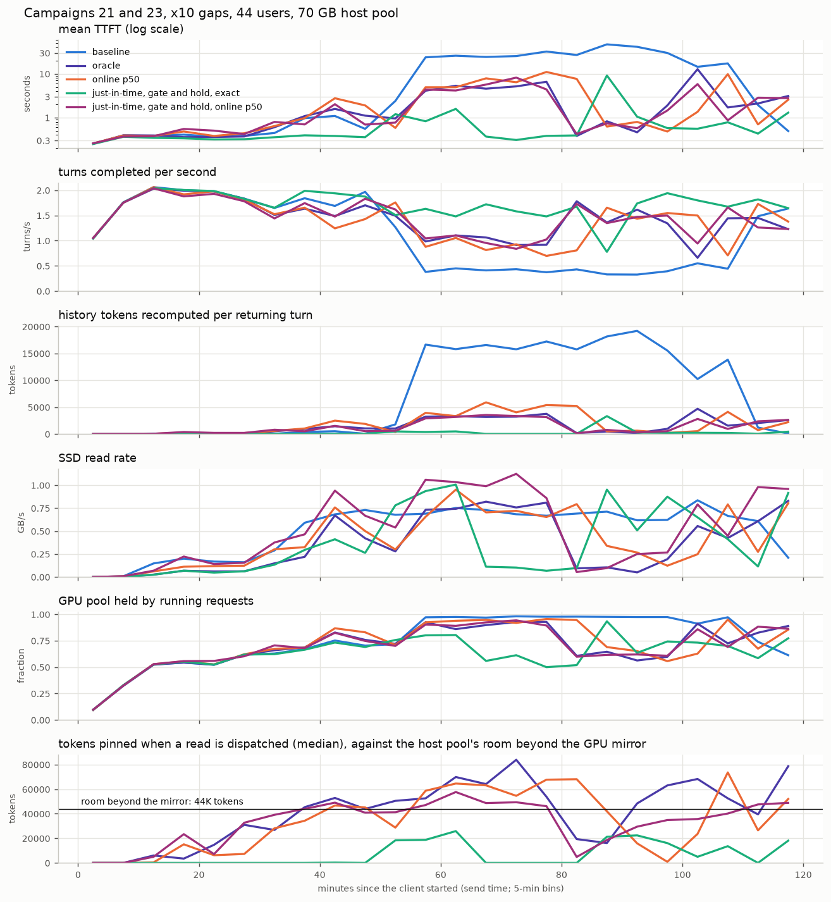
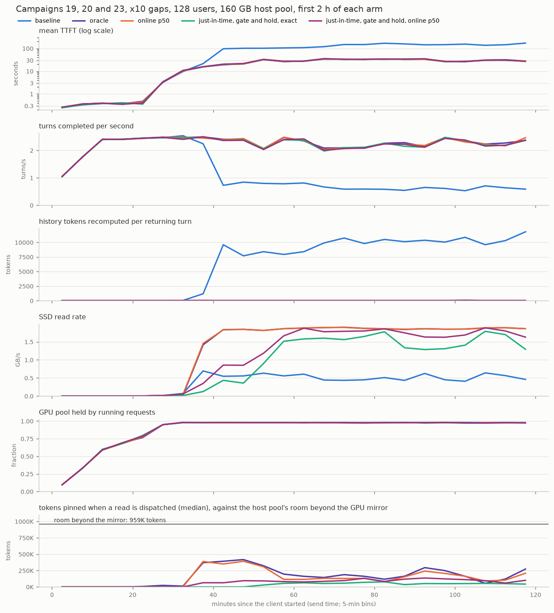

# Campaign 23 findings

Campaign 23 tested the request of 2026-10-31: stop the blind match and fetch at arrival and let the scheduler decide when
to fetch, ideally exactly once per turn. Its last arm finished on 2026-11-02, and no arm had client errors. This note
gathers the findings so the next steps can be chosen from them. The evidence arm by arm is in
`results/campaign23/DECISIONS.md`. Every arm is one run, with no repeats. Updated 2026-11-04 with where the 44-user gain
comes from, which brings in the hint-free arm and corrects several statements below.

## In short

- **At 44 users, about 79 % of the gain over original HiCache needs no hint.** On the same 7,768 turns original HiCache is
  at 5.17 s, and a hint-free arm with read pins (and paced miss retries off) at 1.47 s. Exact hints take that to 0.50 s, all
  of it through the new routine's just-in-time timing; under the old routine they add nothing measurable (1.48 s).
- **With realistic hints the new routine beats the old one, but not the hint-free arm.** New p50 is at 1.51 s against old
  p50's 1.95 s, 23 % lower, and level with the hint-free arm's 1.47 s (0.17 s ahead on the 9,688 turns that reach a second
  heavy stretch, inside the noise). Exact times would still give 1.01 s more, against 0.47 s under the old routine.
- **When the GPU queue is the limit, the gain is I/O only.** At 128 users and 160 GB every hinted arm sits at
  12.06-12.56 s on the same turns, against 53.12 s on original HiCache. With no hint-free arm at this setting, how much of
  that needs a hint is unmeasured. The new routine reads 15 % fewer SSD pages with p50 hints and 29 % fewer with exact hints.
- **The gate and the hold work as asked.** Lookups at arrival that find nothing fall by 90-93 %. No held read went out
  after its turn's admission or was left behind, in any arm.
- **Exactly one fetch per turn holds in one case of four:** 128 users with exact hints. Short host room breaks it at 44
  users, and forecast error breaks it at 128 users.
- **The main problem left looks like reads sent before their turn arrives.** Under p50 hints they hold most of the pinned
  memory at both settings. At 128 users a simple rule should remove them. At 44 users, with exact hints these reads are
  where the gain comes from; with p50 hints they gain nothing on average over an arm that never reads before arrival.
  What to do about them is open.

How the 44-user gain divides is the first part of "What explains the results". The choices and a recommendation are under
"Options for next steps".

## What was tested

The old routine reads a turn's history as soon as it has been evicted and admission is within 120 s. At arrival it also
looks up the SSD for whatever part of the prompt is not in memory, even when that part is only new text. The new routine
changes three things:

- **Just-in-time reads.** A read sent before arrival starts at predicted admission minus read time minus 1 s, and with p50
  hints also minus p50 - p10.
- **The gate.** At arrival, a planned turn whose history is in memory, to within 256 tokens, gets no SSD lookup. Otherwise
  it may look up at most 3 times. A turn with no plan looks up as before.
- **The hold.** A read of a queued turn waits until predicted admission minus read time minus 2 s.

Each setting ran with two hints. **Exact** is the true time of the next request, which a real system does not have.
**p50** is the median gap for the tool call the reply names, from a table the agent system keeps online, which a real
system can have.

## Results

**Baseline** is original HiCache: no hints, no read pins, paced miss retries on. **Hint-free** (44 users only) adds read pins
and turns paced retries off, still with no hints; it ran 117 of its 120 min. **Oracle** is the old routine on exact hints,
**old p50** the old routine on p50 hints, and **new exact** and **new p50** the new routine. All use the same trace, seed and
arrival rate, with gaps stretched by 10.

**44 users, 70 GB of host memory.** TTFT and recomputation are on the 7,768 returning turns all five arms share, lookups
and reads on the 8,008 turns they share, and the last two rows cover each arm's 2 h.

| | Baseline | Oracle | Old p50 | New exact | New p50 |
|---|---|---|---|---|---|
| Mean TTFT, s | 5.17 | 1.48 | 1.95 | 0.50 | **1.51** |
| Recomputed tokens per turn | 2,870 | 977 | 1,329 | 114 | **940** |
| Turns sent in 2 h | 8,037 | 10,319 | 10,021 | 12,201 | **10,419** |
| Arrival lookups that found nothing | 3,461 | 3,051 | 3,092 | 236 | **294** |
| SSD pages | 592,964 | 293,759 | 375,501 | 215,881 | **430,992** |
| Reads per turn that reads | 1.057 | 1.331 | 1.309 | 1.145 | **1.276** |
| Mean pinned tokens | | 39.3K | 32.3K | 6.2K | **30.9K** |
| SSD busy, minutes 45-120 | 31-53 % | 17-37 % | 15-37 % | 22-32 % | **21-52 %** |

**128 users, 160 GB of host memory.** Each arm's first 2 h, because the older arms ran 5 h. TTFT and recomputation are on
the 8,175 returning turns all five arms share. Lookups and reads are on the 16,137 turns the four hinted arms share, since
the baseline reached only about 8,500 turns.

| | Baseline | Oracle | Old p50 | New exact | New p50 |
|---|---|---|---|---|---|
| Mean TTFT, s | 53.12 | 12.06 | 12.14 | 12.46 | **12.56** |
| Recomputed tokens per turn | 3,784 | 35 | 34 | 33 | **34** |
| Turns sent in 2 h | 8,511 | 16,228 | 16,210 | 16,101 | **16,082** |
| Arrival lookups that found nothing | | 6,364 | 6,493 | 472 | **512** |
| SSD pages | | 1,518,868 | 1,523,453 | 1,071,057 | **1,290,748** |
| Reads per turn that reads | | 1.008 | 1.033 | 1.000 | **1.031** |
| Mean pinned tokens | | 148.8K | 127.0K | 32.9K | **66.4K** |
| SSD busy, minutes 45-120 | 39-48 % | 97-98 % | 97-98 % | 47-78 % | **60-92 %** |

## What explains the results

**Where the 44-user gain comes from.** Six analyses and six independent checks, 2026-11-04 (`results/campaign23/gain44/`).
Each arm adds one thing to the one above it, on the 7,410 returning turns all seven arms share:

| Arm | Adds | Mean TTFT, s | Step, s | Share | Recomputed tokens per turn |
|---|---|---|---|---|---|
| Original HiCache | | 5.33 | | | 2,940 |
| Hint-free | read pins, paced retries off | 1.51 | -3.82 | 79 % | 709 |
| Oracle | old routine, exact hints, next-use eviction | 1.52 | +0.01 | 0 % | 1,000 |
| `jit_70` | just-in-time timing | 0.67 | -0.85 | 18 % | 229 |
| New exact | gate and hold | 0.49 | -0.17 | 4 % | 112 |

On the 7,768 turns without `jit_70` the steps are -3.71, +0.02 and -0.98 s. 70-90 % of each step is shorter queue wait.

- **Pins.** Without them original HiCache reads history back from the SSD and loses it again before the turn is admitted:
  2,375 of its 2,870 recomputed tokens per turn. A landed read is lost 2 % of the time when admission follows within
  0.5 s, and 99.6 % of the time when it follows 15-60 s later. Pins hold the read until admission, and the hint-free arm
  loses none; it also reads each turn at most once (1.000 reads per reading turn on the 7,973 turns all six 2 h arms
  share). Pins and paced retries off arrive together, so which of the two does it is inferred. Deadline order and the
  read window do nothing without hints, because every read is due at once.
- **Why the old routine adds nothing.** It gains 0.69 s per turn in the main episode and loses 0.34 s per turn in the
  calmer stretches either side, so the means tie while the tails differ (p90 2.87 s for hint-free against 4.31 s, p99 19.7 s
  against 15.6 s). Its staged reads land a median 9.8 s (p90 48 s) before admission and hold 89 % of pinned token-seconds:
  39.3K on average against about 44K tokens of host room, and more counting the history each pin keeps above it.
- **What just-in-time timing removes.** With host room gone, reads are revoked at launch or cut: 88 % of the oracle's
  recomputed tokens are history the SSD held but the read did not load, and about 8 % more are holes left by write-through
  backups skipped for lack of room (backups cover 80 % of new tokens, against 95 %). Starting reads at load plus 1 s before
  admission lands them 1.7 s ahead, cuts mean pins to 6.2K and recomputation from 977 to 114 tokens per turn. Timing alone
  (`jit_70`) gives about 85 % of that and of the TTFT gain.
- **How saved recomputation becomes TTFT.** A turn's own extra recomputation is only 11-14 % of the 0.98 s gap. 71 % is
  queue wait, and 8 % the wait behind the prefill batch already running when the turn is sent. Most of the prefill a queued
  oracle turn waits behind is other turns' recomputed history (80 %; 87 % of the extra wait). The 64-request cap never
  binds. The GPU pool fills (0.91 against 0.77 in the episode) and evicts what queued and returning sessions need next.
- **Where it sits.** 75 % of the gap is in one load episode, positions 5,500-7,000 (oracle minutes 54-79). The 14 % of
  turns the oracle queued 1 s or more carry 91.5 % of it. Medians barely move (0.26-0.36 s in every arm): it is a tail effect.
- **Not eviction code.** The three engine freezes share the same eviction, tree, pin and backup code. New exact serves more
  history from the GPU (21,710 against 19,661 tokens per turn) mostly because it spends less time congested: at equal GPU
  use the arms keep the same device share. A staged read evicting another session's soon-needed host copy happens, but
  carries at most about 12 % of the gap.
- **With p50 hints.** New p50 gains 0.44 s over old p50, in the same episode and as queue wait. Most of it is turns the old
  routine re-fetched up to its cap of 2 after their reads were denied host room (405 such turns go from 10.7 s to 4.6 s).
  The pin saving is gone: staged pins stay at about 27K, because reads still land about 5 s early, 72 % of that from the
  deliberate p50 - p10 early start. The forecast also leaves 2.7 times as many turns needing an SSD read as exact hints do
  (1,925 against 723), which is eviction acting on wrong times.

How sure: every arm started with an empty SSD, replayed the same workload (identical gaps, prompts within 0.3 tokens on
average) and ran at the same speed (hint-free 0-4 % slower if anything). With one run per arm, within-run 95 % intervals,
before run-to-run noise, are +1.4 to +6.7 s for the pin step, which rests on one baseline storm; about +-0.5 s on the ties;
+0.4 to +1.4 s for just-in-time timing; and +0.03 to +0.41 s for the gate and hold. `jit_70` ran 75 min, so the last two
steps cover only the first heavy stretch, while 27 % of the oracle-to-new-exact gap on the 9,980 turns those two share lies
past position 8,750.

**The forecast costs where host room is short.** The forecast error is the same at both settings: actual minus predicted
arrival is p10 about -5.5 s, median -0.3 s, p90 +4.9 s. Its cost is not. Against exact hints it costs 1.01 s at 44 users,
and 0.07 s at 128 users on 15,503 shared turns (0.10 s under the old routine).

- At 44 users only about 44K tokens of host memory are free beyond the GPU mirror, and a read that lands early stays
  pinned until its turn is admitted. With p50 hints 1,743 of 5,001 read launches are revoked for lack of room, against 381
  of 2,088 with exact hints, and 88 % of recomputed tokens sit on turns whose read found its data but was cut or revoked.
- Mean pins over 2 h do not order recomputation across designs: the oracle pins more than old p50 (39.3K against 32.3K)
  yet recomputes less (977 against 1,329), and the hint-free arm pins 9.3K yet recomputes 680. What follows pins is the
  revoke rate at the moment a read launches, and, within the p50 pair, recomputation block by block (correlation +0.58).
- At 128 users the room is 959K tokens and pins peak at 401K. No read is revoked while the client is sending, and
  recomputation stays at 34 tokens per turn.

Two limits on this reading: the settings differ in users as well as memory, and eviction also runs on the forecast, so at
44 users pins and eviction are not separated. Eviction on the forecast does show: with p50 hints 2.7 times as many turns
need an SSD read as with exact hints, and device hits are lower already in the calm first stretch.

**Reads sent before the turn arrives are what a forecast damages.** With exact hints such a read lands a median 1.7 s before
admission (p90 2.5 s, 44 users). With p50 hints it is 4.7 s (p90 24.6 s) on the shared turns, and 5.2 s (p90 38.3 s) over
all staged reads of the run. Under p50 hints, turns whose read came due before
arrival hold 93 % of pinned token-seconds at 44 users and 66 % at 128 users, for different reasons:

- At 44 users there is little queue (median wait estimate 1.0 s, read time 2.5 s), so most of these reads have to start
  before the turn arrives. 87 % of pinned token-seconds come from reads due ahead of the forecast arrival. Of the long
  pins, about half are true gaps above the key's p90 and half the deliberate early start by p50 - p10.
- At 128 users the queue wait is about 25 s, so almost no read needs to start early: 17 do with exact hints. With p50 hints
  515 do, and 463 of those came due with the forecast arrival already missed, by a median 12.5 s and with the turn still
  away. The routine goes on assuming the turn arrived on time and is queueing. These turns hold 56 % of pinned
  token-seconds, and 508 of the 515 had a wait estimate above read time plus 1 s, so they could have waited for the turn.

**One fetch per turn needs both room and good timing.**

| Reads per turn that reads | Exact | p50 |
|---|---|---|
| 44 users, 70 GB | 1.145 | 1.276 |
| 128 users, 160 GB | 1.000 | 1.031 |

- At 44 users the extra reads are mostly remainders: eviction cannot free the whole span, so the first read is cut short
  and the next fetches the rest (all 224 such turns with exact hints, 646 of 672 with p50). Pages are rarely read twice:
  268 of 434,495 with exact hints, about 14,700 of 610,945 with p50.
- At 128 users reads are almost never cut (3 of 4,298) and every double read has one cause. The read lands before its turn
  arrives, the plan times out 60 s after the forecast arrival and releases the pin, the span has left host memory by the
  time the turn comes, and the turn reads it again. That is 129 turns and 37,070 pages, 2.9 %.

**At 128 users the GPU queue decides TTFT.** Of about 21 s per returning turn, queue wait is 20.5-20.9 s and everything after
admission is 0.42 s in every hinted arm. From minute 45 the GPU pool is 0.98 full, with about 30 requests running and 59-73
queued. The hinted routines already removed what memory was costing against original HiCache, so no read routine can
shorten what is left; whether read pins alone would do the same here is unmeasured. What the new routine adds is SSD
headroom, and what that buys is unmeasured because the GPU is the limit.

**Both new arms at 128 users trail their old-routine rivals by about 0.4 s.** That is +0.40 s with exact hints and +0.38 s
with p50 hints on about 15,500 turns, with 0.8 % fewer tokens generated. I first read this as GPU speed. The p50 arm weakens
that: its early decode is only 0.3 % slower than its rival's, yet it lags as much. Routine and GPU unit arrive together, so
this needs a repeat on one unit.

**The hold is sound, and late reads follow the SSD's ceiling.** Holds per arm were 173, 470, 3,203 and 2,826, dispatched a
median 3.2-4.8 s before admission. Even so, at 128 users a read can land after its turn could have gone.

| Reading turns queued 5 s or more | Oracle | Old p50 | New exact | New p50 |
|---|---|---|---|---|
| Passed by a later arrival | 4.5 % | 25.9 % | 16.7 % | 32.1 % |
| Delay per reading turn, s | 0.18 | 1.73 | 0.61 | 1.62 |

Turns without a read are never passed. The turn's own forecast is not the cause: the share is 31-34 % whether the forecast
was right or off by up to 30 s. It follows the SSD. With reads under 1.6 GB/s around the admission the two new arms match
(4-6 %, 9-10 %, 17 %). At 1.8 GB/s or more new p50 is at 48 % and new exact at 20 %, and 47 % of new p50's reads fall there
against 8 %. The ceiling is about 1.85 GB/s, and new p50's 20 % more pages push it there.

**A rough capacity figure.** Read from swings in one run, the load carried at a mean TTFT of 5 s rises over the baseline by
11 % with exact hints and 6 % with p50 hints (1,055K, 1,176K and 1,117K tokens). The 44-user setting sits on a steep knee, so
mean TTFT there can overstate the gain. At 128 users every hinted arm is far past the knee. The hint-free arm has no such
curve yet, and by load band it does worse than the oracle near the knee (3.93 s against 2.69 s at 1,050-1,100K tokens,
15 minutes each), the opposite of the tie on matched turns; load is partly an effect, so neither reading is settled.

## How far this can be trusted

- **One run per arm.** The oracle's spread at 44 users was once measured at 0.05-0.14 s on runs since deleted, and 128 users
  has no estimate. So the gaps of 0.07-0.4 s at 128 users and the 0.17 s from the gate and hold are not known to be real,
  and the 79 % from pins at 44 users rests on one baseline storm.
- **Changes arrive together.** The older arms ran on an older engine, `engine_5df71c4bf0_v2`. At 128 users nothing separates
  read timing, the gate and the hold.
- **The settings differ in users and memory at once,** so "room" against "users" is a reading, not a result.
- **GPU units.** The preemptible host changed unit twice on 2026-11-01. All four new arms ran on one unit, `GPU-b59d6a34`, and
  the older arms' units are unrecorded. Speeds match at 44 users, except that 8,192-token prefill chunks run 1.7-2.3 %
  slower on the new arms' engine, which works against them. At 128 users early decode differs by up to 2 %.
- **Workload.** A batch-agent trace with gaps stretched by 10, in a closed loop. Real use has long human waits.

## Options for next steps

Each 2 h arm takes about 2 h 5 min, and a preemption loses at most the arm in progress.

| | Step | What it answers | Work | GPU time |
|---|---|---|---|---|
| A | Send a read before arrival only if the queue wait could not cover it; rerun p50 at 128 users, and at 44 users to check it does no harm | Does p50 reach one fetch at 128 users, and how much of the I/O saving comes back? It would touch 99 % of such reads at 128 users and 14 % at 44 | Small engine change | 4 h |
| B | At 44 users, exact gaps for eviction and p50 for reads | Is the 1.01 s read timing and pins, or eviction on the forecast? Decides whether C is worth running | Small engine and client change | 2 h |
| C | Lighter pins at 44 users: no early start by p50 - p10, a time limit on pins, or holding a read until room appears | How much of the 1.01 s comes back | Small each, none built | 2 h each |
| D | Repeats on one recorded GPU unit: new exact, new p50 and oracle at 44 users; new exact and oracle at 128 | Which gaps are real, including the 0.4 s at 128 users | None | 10 h |
| E | User-count sweep, best routine against the baseline | Sessions per GPU under a latency target, the number an operator buys | None | 20 h for 5 counts |
| F | Campaign 22, the step-by-step ladder at 128 users | Whether the 128-user gain over original HiCache needs a hint; at 44 users 79 % does not | Check its launcher against today's `start_server.sh` | 6 h, 8 h if its first arm (the 44-user hint-free arm again) is not skipped |
| G | Analyse the hint-free arm at 44 users | Done 2026-11-04: see "Where the 44-user gain comes from" | | |
| H | At 44 users, read pins with paced retries left on | Which of the two carries the 79 % | A new arm in `start_server.sh` (server flags only) | 2 h |

**My recommendation.** G changes the order. At 44 users realistic hints add nothing measurable over read pins alone, so
whether hints matter at 128 users is now the first question for the paper: run F there, at least its hint-free arm (2 h). Then
run A and B as one campaign of about 6 h: A answers the one-fetch goal at 128 users, and B says what the 1.01 s is. Run H if
the paper must name the lever behind the 79 %, and C only if B points at pins. Hold D until the routine settles, so repeats
are not spent twice. E comes last.

The engine work behind all of this is uncommitted in `python/`. Committing it before A or B would give those changes a clean
diff. The paper's other open items (human-paced workload, prior-work recheck, venue and deadline) are in `PAPER_PLAN.md`.

## Small issues logged

- A read still in flight at shutdown hit the freed host pool (`AttributeError` at `mha.py:696`), once, after the client ended.
  Not fixed.
- With p50 hints at 128 users 19 % more turns read than with exact hints. Turns that came 5 s or more before the forecast read
  about twice as often (280 to 549), and those that came 1 s or more after read less (1,257 to 1,014), which looks like
  eviction acting on the wrong time. Turns forecast within 1 s also read more (1,532 to 2,097), with no direct evidence why.
- New p50 reads 15 % more pages than old p50 at 44 users, because its reads are larger (244 pages per reading turn against 188).
- On held reads at 128 users the queue estimate runs later than real admission by a mean 1.57 s with p50 hints and 0.46 s with
  exact hints. The read estimate does not differ, and turns passed ahead explain only 0.09 s of that gap. Not explained.
- Under the old routine p50 is passed five to six times as often as the oracle at the same SSD rate, which the ceiling cannot
  explain.
- The lookup cap refused 25 lookups with exact hints and 215 with p50 at 44 users, and none at 128 users.
- The spike near position 8,750 at 44 users appears in every arm in the same 250-position bin, so the workload sets it off,
  but the arms differ in depth and recovery: past position 8,750 new exact averages 1.93 s against the oracle's 3.77 s on
  1,519 shared turns. The hint-free arm's later episodes there are deeper than any hinted arm's (8.3 and 11.3 s); cause open.
- Below the knee at 44 users new p50 is slower than the baseline (0.42 s against 0.37 s, 0.94 s against 0.72 s). New exact
  is not, nor is the hint-free arm (0.36 s, 0.65 s).
- `ntp_reevict` is logged after any re-fetch that leaves history missing, not only when fetched pages are evicted again:
  35-51 % follow a read revoked at launch. The engine comment and "re-fetched spans evicted again" in `DECISIONS.md` overstate it.
- A read launch that finds too little free host room asks `evict_host` for the whole read, not the shortfall, in all three
  engines. Backups ask for the shortfall but free 2.5-3.7 times as much, whole leaves at a time.
- A write-through backup skipped for lack of host room leaves no log line, only a Prometheus counter. Backup-path evictions
  that freed less than they needed show at least 190 skips in the oracle and 26 in new exact.
- At equal pinned tokens at launch the revoke rate differs by arm (16 % for hint-free against 31-50 % at 44-60K pinned), so
  something besides pins sets it. Not found.
- The scheduler's `batch_is_full` flag stays set after a refusal for lack of memory until a running request finishes.
- `read_start_timing.py`'s "case 2" row misreads the hold, because it reports the planned trigger and not the dispatch.
- `results/compare_c24_jit_vs_c21/` still draws attempts since deleted, and `c24_probe/jit_table.py`, `plot_jit.py`,
  `c21_x10_c44/plot_overview.py` and `plot_standard.py` no longer run.
- Two tests in `test_pp_prefetch_ticket.py` fail the same way on this engine and on `engine_table_20261101`.

## Where the data is

| Arm | 44 users, 70 GB | 128 users, 160 GB |
|---|---|---|
| Baseline | `20261101_082229_three_tier_wc_custom_L1nat_H70` | `20261018_103544_three_tier_wc_NAT160` |
| Oracle | `20261101_102434_three_tier_wc_oracle_v2_nu_custom_L1nat_H70` | `20261018_154254_three_tier_wc_oracle_v2_nu_NAT160` |
| Old p50 | `20261101_062014_three_tier_wc_oracle_v2_nu_custom_L1nat_H70` | `20261031_204526_three_tier_wc_oracle_v2_nu_NAT160` |
| New exact | `20261101_202142_three_tier_wc_oracle_v2_nu_owned_custom_L1nat_H70` | `20261102_002657_three_tier_wc_oracle_v2_nu_owned_NAT160` |
| New p50 | `20261101_222451_three_tier_wc_oracle_v2_nu_owned_custom_L1nat_H70` | `20261102_023031_three_tier_wc_oracle_v2_nu_owned_NAT160` |
| Hint-free | `20261101_122705_three_tier_wc_dl_poll0_custom_L1nat_H70` | none |
| `jit_70` | `20261101_050233_three_tier_wc_oracle_v2_nu_jit_custom_L1nat_H70` (75 min) | none |

Run folders are under `results/`. Tables are in `results/campaign23/`, figures in `results/compare_c23_c44/` and
`results/compare_c23_c128/`, scripts in `frozen/oracle_scripts_staging/c23_engine/`, and the engine in
`frozen/engine_owned_20261101/python`. The 2026-11-04 analysis of the 44-user gain is in `results/campaign23/gain44/`: the
analysts' results `w1_*.json`, the checks `w2_*.json` and every cited output, with scripts in
`frozen/oracle_scripts_staging/c23_gain44/`. `frozen/` is excluded from git. Mean pinned tokens here use one definition for every
arm, each arm's first 2 h, so new exact at 44 users reads 6.2K where `DECISIONS.md` also has 6.7K, which counts pins after the
client stopped.
