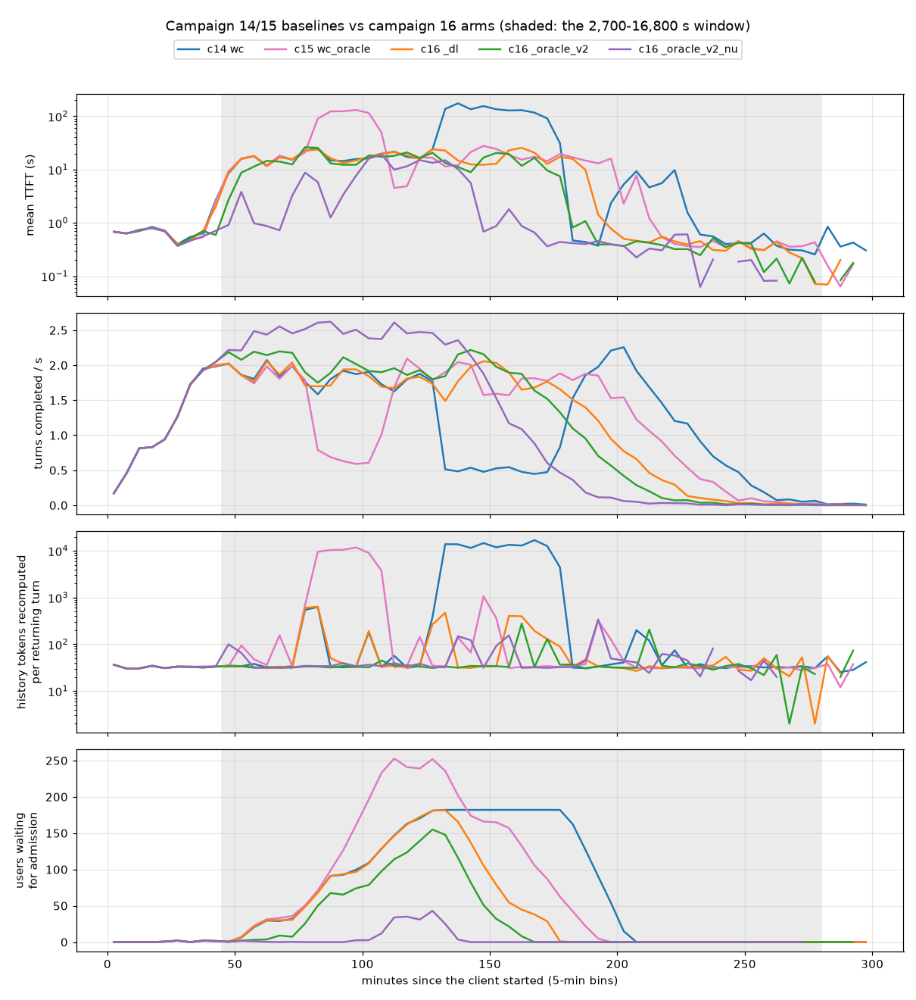
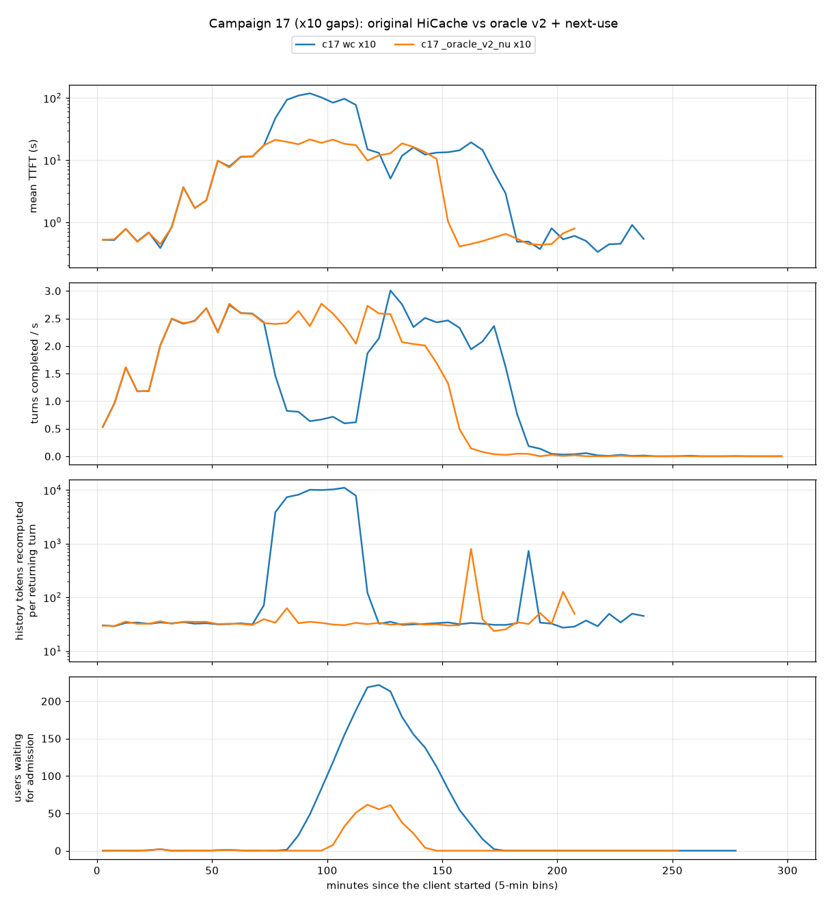
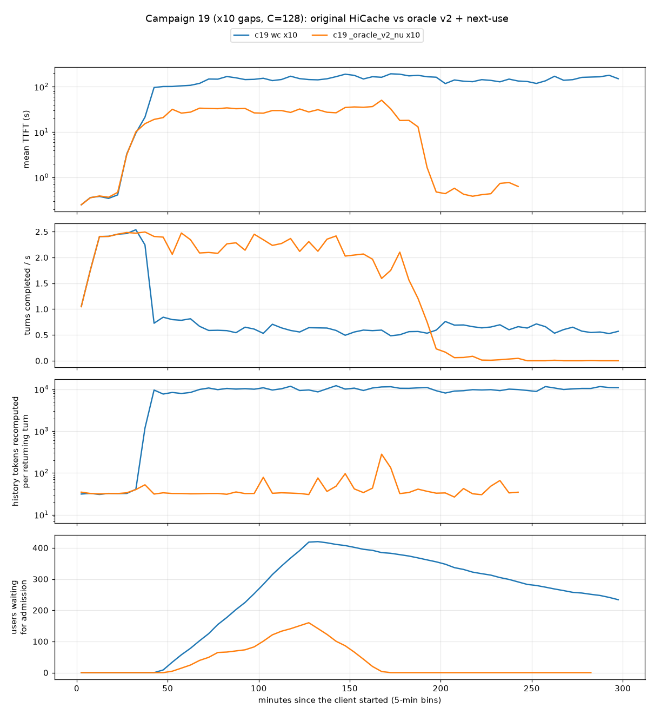
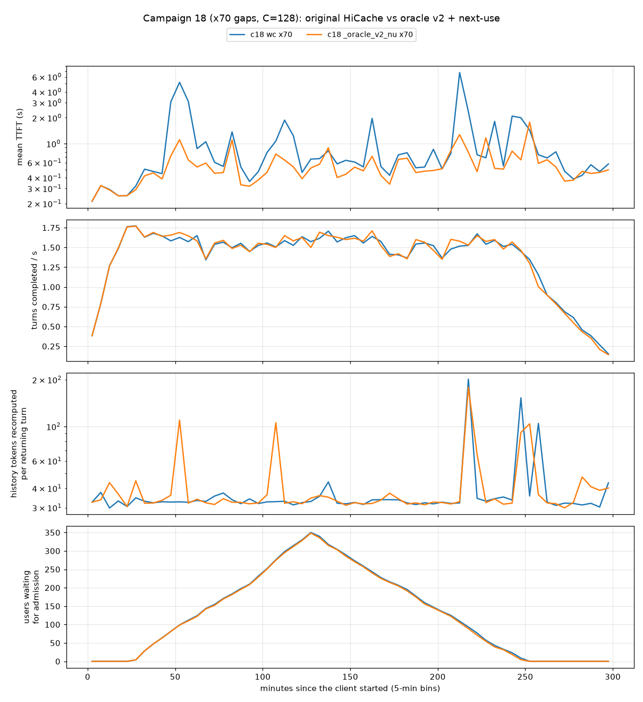

# Next-turn KV staging for agentic serving: findings from campaigns 14-19

Written 2026-10-12 after campaign 16; campaign 17 (the same workload at x10 gaps) added 2026-10-13; campaigns 18 and 19
(x70 and x10 gaps on a redesigned replay client) added 2026-10-18. This document is self-contained: it explains the
setup, the terms and every result, so a reader needs nothing else to follow what was done and what it showed. The
design documents (`ORACLE_PLAN.md` for v1, `ORACLE_V2_PLAN.md` for v2, `REPLAY_REDESIGN.md` for the client of
campaigns 18-19) and the step-by-step procedure (`ORACLE_V2_HANDOFF.md`) hold more depth but are not needed here.
Where each number comes from is in section 12. A glossary is at the end.

---

## 1. Summary

- **Setting.** One H200 serves Qwen3-30B-A3B to 768 replayed agent sessions (SWE-bench, GAIA) with a three-tier KV
  cache: GPU memory, 160 GB of host memory and a 2.3 TB SSD. Between two turns of a session the agent runs a tool, so
  the session's KV sits idle and gets pushed down the tiers. A returning turn finds its history on the GPU, in host
  memory, on the SSD (about 2 GB/s, roughly 1.5 GB per restore), or nowhere (then it is recomputed). The SSD read path
  is the bottleneck.
- **Question.** If the server knows when each session's next turn will arrive (a hint from the agent framework), can
  it have the right KV in the right tier in time? The hints used here are exact (an oracle), so every gain is an upper
  bound for a real predictor.
- **The baseline loses fetched data.** In the write-through baseline, 665 returning turns had their SSD read finish
  and were still recomputed: the fetched span was evicted from host memory while the request waited for admission.
  That was 59 % of all recomputed history in the run (67 % in campaign 15's oracle v1 run). Under load each loss adds
  prefill work, which lengthens the queue, which causes more losses. Both of those runs fell into such a "recompute
  storm" for 30-50 min (mean TTFT 100-180 s, throughput down to a third).
- **Oracle v1 (campaign 15) gained little under `wait_complete`** (mean TTFT -1.4 s): staged reads queued about 30 s
  in one FIFO, held host memory while queued (39 % of the pool), and so reduced host hits from 16 % to 10 % of returns
  on an already saturated SSD.
- **Oracle v2 (campaign 16) changes four things**, tested as three cumulative arms. Mean TTFT over the same 20,217
  turns:

| c14 baseline | c15 + oracle v1 | `_dl`: pin fetched spans | `_oracle_v2`: + deadline-ordered reads | `_oracle_v2_nu`: + next-use eviction |
| ------------ | --------------- | -------------------------- | ---------------------------------------- | -------------------------------------- |
| 18.5 s       | 17.3 s          | 13.2 s                     | 11.6 s                                   | **5.7 s**                        |

- **Pinning** a fetched span until its request is admitted (`_dl`, needs no hints) removed the lost-after-landing
  failure entirely (0 turns) and with it the storm: p99 TTFT 169 s -> 46 s.
- **Reading in deadline order**, with host memory taken only when a read starts (`_oracle_v2`), cut the host memory
  held by waiting reads from 28 % to 2 % and added a small gain (-1.6 s against `_dl`).
- **Evicting by predicted next use** (`_oracle_v2_nu`) raised host hits from 14 % to 41 % of returns, cut SSD reads by
  19 % and gave the largest gain. It finished the whole workload in 4.5 h; the baseline still had 3 users live at 5 h.
- **At x10 gaps (campaign 17), against the original HiCache baseline.** Sessions return seven times sooner, so history
  mostly stays in host memory and the GPU becomes the limit. Oracle v2 + next-use cut mean TTFT from 15.8 s to 11.2 s,
  p95 from 90.5 s to 24.2 s and p99 from 116 s to 28 s on the same 20,293 turns.
  - All of that gain is one 39-min storm in the baseline, and the cause differs from x70. The baseline's paced retries
    spend each request's 8-attempt SSD lookup budget polling for the turn's new messages, which are never on the SSD.
    When the request's history is then evicted while it waits in the queue, the admission-time re-query that would
    re-read it is refused, and the history is recomputed: 90.7 % of the baseline's recompute.
  - The oracle arm kept its budget (paced retries off) and re-read all but one of the histories it lost while queued
    (refetch, held by pins). Next-use eviction did not make those losses rarer before the storm: at 70-75 min both
    arms lost queued history equally often. The oracle was busy, not idle: it doubled SSD reads.
  - How much of the gain the hint-free changes (paced retries off, and the pins) would give on their own is not
    measured; section 8.7 names the arms that would decide it.
- **On a redesigned client (campaigns 18-19), the same two arms.** The replay client was rebuilt so that a run
  depends only on the arrival rate, the gap scale and a fixed number of users in session (128, idle users included).
  Every user now replays its whole session from the first turn (24,879 turns), so these runs do not pair with
  campaigns 14-17.
  - **At x70 (campaign 18) the server was lightly loaded** (mean TTFT about 1 s) and neither arm stormed. The users'
    own sleeps set the pace: throughput and the queue of users waiting to start were the same in both arms. The oracle
    arm cut mean TTFT from 1.09 s to 0.58 s and p99 from 12.1 s to 5.2 s on the same 24,734 turns. That difference is
    within the run-to-run spread seen so far.
  - **At x10 (campaign 19) the baseline stormed 38 min in and never recovered**, because with 128 users always in
    session nothing sheds load (campaign 17's client cut its users in session during the storm). In 5 h it served
    15,033 turns and finished 413 of the 768 users; 232 never started. On those 15,033 turns its mean TTFT was 95.8 s
    against 20.3 s in the oracle arm, which finished all 768 users in 4.7 h. The cause is campaign 17's: 95 % of the
    recompute came from turns whose lookup budget the paced retries had spent.
  - The x10 oracle arm broke one rule set before the run: no planned turn may wait 60 s or more to be admitted,
    because after 60 s in the queue next-use eviction ranks a session overdue and evicts it early. 67 turns (0.3 %)
    waited 60-72 s, all in the 5 min after an SSD cleanup; 3 of them recomputed more than a page (section 9.6).
- **What it means.** The pin fixes a failure of the current engine and needs no prediction, so it is the first
  candidate to upstream. Next-use eviction carries the large gain at x70, and how much of it survives depends on how
  good real next-turn predictions are: that is the next thing to measure. Deadline ordering helps only a little while
  the SSD is saturated. At x10 the first thing to fix in the baseline is how paced retries spend the lookup budget:
  under steady load the resulting storm does not end on its own (campaign 19). Whether hints add much beyond that fix
  at x10 is open.
- **Not yet established:** each arm ran once; the hints were exact; nobody has checked that restored KV is correct;
  the share of the x10 gain that needs hints; how the design does at x70 under a load that tests the server on the
  redesigned client; one model, one GPU, one SSD. Section 10 lists what each caveat affects, section 11 the next
  steps.

---

## 2. Setup

### 2.1 Hardware, model and cache tiers

| item            | value                                                                                                                                                                                             |
| --------------- | ------------------------------------------------------------------------------------------------------------------------------------------------------------------------------------------------- |
| GPU, model      | one H200; Qwen3-30B-A3B-Instruct-2507 (MoE, 3B active), bf16 KV, TP 1, triton attention, context 131,072                                                                                          |
| KV size         | 96 KiB per token (48 layers x 4 KV heads x 128 dims x K and V x 2 bytes); a page is 64 tokens = 6 MiB                                                                                             |
| L1, GPU KV pool | 668,160 tokens (~61 GiB)                                                                                                                                                                          |
| L2, host pool   | 160 GB = 1,627,648 tokens                                                                                                                                                                         |
| L3, SSD         | NIXL file backend on a 2.3 TB disk (`/mnt/ssd`), wiped before each run; reads ~2 GB/s when busy, ~3 ms per page                                                                                 |
| SSD cleaner     | when the disk passes 70 % full, deletes the oldest files down to 60 % (about 230 GiB per cleanup)                                                                                                 |
| write policy    | write-through: everything prefilled on the GPU is copied to host memory and on to the SSD                                                                                                         |
| prefetch policy | `wait_complete`: a request whose history is on the SSD waits for its read before admission. (`timeout`, the other policy studied, waits up to a deadline and recomputes what has not landed.) |
| scheduler       | FCFS, at most 64 running requests, chunked prefill 8,192 tokens, page size 64                                                                                                                     |

Under write-through a host copy can only be evicted after its GPU copy is gone, so 41 % of the host pool always mirrors
the GPU pool. What is left holds host-only contexts and, while reads run, the pages they are filling.

A returning turn's history is served from one of four places, at very different costs:

| source      | cost (campaign 15, p50)                                                                                        |
| ----------- | -------------------------------------------------------------------------------------------------------------- |
| GPU         | nothing to load                                                                                                |
| host memory | ~0.3 s TTFT                                                                                                    |
| SSD         | ~22 s TTFT under load, almost all of it queueing behind other reads (a typical restore is ~250 pages, ~1.5 GB) |
| recompute   | prefill of the lost tokens on the GPU, which delays every other request                                        |

### 2.2 Workload (campaigns 14-16; campaign 17 changes only the gap scale, section 8.1; campaigns 18-19 use a redesigned client, section 9.1)

- **Sessions.** The LMCache agentic trace: 768 real agent sessions (665 SWE-bench via OpenHands, 94 GAIA, 9 WildClaw;
  12 system prompts). Each simulated user replays one session once, with real message contents; the server generates
  the replies. Each session is cut to min(recorded length, uniform 30-50) turns: 20,232 turns in all; the longest
  prompt is 98K tokens; a typical returning turn carries 20-30K tokens of history.
- **Gaps.** Between a reply and the next request the client sleeps the recorded gap x 70, capped at 1,200 s (the
  recorded median is 0.7 s). The scaling makes the gaps long enough that sessions leave the GPU between turns.
  Campaign 17 scales by 10 instead.
- **Arrivals.** New users arrive as a Poisson process at 0.1 per second; all 768 have arrived after about 2.1 h. The
  first 128 start in the middle of their session, so the run does not begin with an empty cache.
- **Admission cap.** The client limits how many users are live. Every 120 s it moves the cap toward a target of 32
  requests waiting for their first token (by half the difference, at most 8 users per step, between 16 and 512).
  Arrived users beyond the cap wait to start.
- **Length.** 5 h per run. The workload is finite, so a faster system runs out of users before the 5 h are up.
- **Hints.** With every request the client sends the id of the session's next request and the exact time it will
  sleep after this reply (`next_gap_s`). These hints are exact: the oracle. Campaign 14's client sent none; a server
  without the oracle ignores them.

### 2.3 Metrics

- **TTFT** (time to first token) of each turn, measured by the client.
- **Shared turns.** The 20,217 (user, turn) pairs that all five compared runs completed (campaign 17: all 20,293 of
  its two arms; campaign 18: 24,734; campaign 19: the 15,033 its baseline completed). Because every run serves the
  same finite workload, the mean TTFT over these turns compares like with like. Paired differences take the same turn
  in two runs; their 95 % intervals resample users (a user's turns are correlated), and they cover variation within a
  run, not between repeated runs.
- **Wait to be admitted.** The time a user waits for a place under the cap before its session starts, in user-hours.
  TTFT does not include it. In campaigns 18-19 a user who never started counts from its arrival to the 5 h stop.
- **Window 2,700-16,800 s.** The measurement window of the earlier campaigns (after warm-up, before the end), kept for
  continuity. Late in the window the faster arms are already draining, so it holds different parts of the workload per
  run. Campaign 17 uses 2,700-15,000 s, because its oracle arm's client ends at 15,008 s.
- **Turns/s while congested.** Throughput in the 5-min bins whose median TTFT exceeds 10 s.
- **Time until N users finished.** The throughput measure for a finite workload.
- **Returns by source.** A returning turn counts as "recompute" if more than half of its prompt beyond the shared
  system prompt was uncached, else "SSD" if any of it came from the SSD, else "host" if any came from host memory, else
  "GPU". A large new tool output also makes a turn "recompute", so about 7 % is a floor. The token view (how many
  history tokens came from each source, and how many were recomputed) avoids that floor; both are reported.
- **Little's law.** Mean TTFT = mean backlog / throughput held within 0.4 s in every run, and while the cap binds it
  holds the backlog near its target. A better cache therefore shows up as more turns per second, as fewer congested
  episodes, and as lower TTFT mainly once the cap stops binding.

---

## 3. Background: what earlier campaigns established

- **Campaign 7 (x70 gaps).** SSD restores go through one FIFO read thread; a restored turn spent 58-80 % of its TTFT
  waiting for reads queued ahead of it, 15-17 % on its own read.
- **Campaign 10 (recorded gaps, no scaling).** The SSD only serves returns after long human pauses (2-3 % of returning
  turns); TTFT about 1 s.
- **Campaign 11 (x10 gaps).** Prefixes evicted while a request waited were lost; re-querying the SSD at admission
  (upstream sglang #39283) cut mean TTFT from 116 s to 68 s.
- **Campaign 13.** The server alternated between an SSD-bound state and a light state, driven by the client's fixed
  replay order. Campaign 14 changed the client (every user a different session, the backlog-driven cap, the mid-session
  start) and defined the workload of section 2.2.

Campaign 14 is the baseline for everything below:

| campaign 14, window 2,700-16,800 s        | `wait_complete` (wc) | `timeout` (to)      |
| ----------------------------------------- | ---------------------- | --------------------- |
| TTFT mean / p50 / p90                     | 22.2 / 10.4 / 40.4 s   | 53.3 / 10.7 / 155.4 s |
| turns/s; users finished in 5 h            | 1.22; 765              | 0.99; 646             |
| returns from GPU / host / SSD / recompute | 21 / 16 / 50 / 13 %    | 11 / 26 / 28 / 35 %   |
| SSD read / written                        | 15.6 / 3.4 TB          | 11.0 / 7.9 TB         |

`wait_complete` was the better policy, and the rest of this document is about it.

---

## 4. The baseline's main failure: fetched data lost before admission

The figure in section 7.2 shows it. From about 2.1 h to 3.0 h, campaign 14's wc run had a mean
TTFT of 100-180 s, completed 0.5 turns/s instead of 1.8-2.0, and recomputed 10,000-13,000 history tokens per
returning turn (normally about 35). Campaign 15's run had the same episode from 1.3 h to 1.8 h.

The server logs say why. A turn "lost a read after landing" when its SSD read completed (`HiCache prefetch success ... loaded=N`) and its admission nevertheless credited less than half of N as coming from the SSD and recomputed more than a
page:

| run                                           | turns that lost a read after landing | their recomputed tokens | share of all recomputed history |
| --------------------------------------------- | ------------------------------------ | ----------------------- | ------------------------------- |
| c14 wc                                        | 665                                  | 12.2M                   | 59 %                            |
| c15 wc + oracle v1                            | 509                                  | 8.9M                    | 67 %                            |
| c16`_dl`, `_oracle_v2`, `_oracle_v2_nu` | 0, 1, 3                              | 0.0-0.1M                | 0-7 % of a far smaller total    |

In campaign 14's storm the typical such turn had 17,120 tokens loaded from the SSD, 0 credited at admission and
17,111 recomputed. The mechanism:

1. A finished read is inserted into the cache as an ordinary host entry. Nothing protects it until its request
   reaches admission, which under load is tens of seconds later.
2. The host pool is crowded: 41 % mirrors the GPU, and reads still waiting in the FIFO held another 23-39 %, so the
   rest turns over within a minute.
3. The fetched span is evicted, and the request recomputes the history it had already paid to read.
4. Recompute takes GPU time, so every request waits longer, so more fetched spans are evicted: the storm. The other
   third of the storm's recompute came from requests that used up their 8 SSD lookup retries while waiting (384 such
   requests in the run). It ended when the admission cap had cut the number of live users enough.

The volume adds up. SSD writes fell from 3.4 TB (campaign 14) to 1.6 TB (`_dl`), and the recompute that disappeared
between those two runs, 18.7M tokens x 96 KiB, is 1.8 TB: recomputed history is written through to the SSD a second
time.

At x10 gaps the same baseline fails in a different way: history lost while queued after the retry budget is spent
(section 8.5). Campaign 19 repeats that failure on the redesigned client, and there it never ends (section 9.4).

---

## 5. Oracle v1 (campaign 15)

**What it does.** With `--hicache-storage-next-turn-prefetch on`, the server keeps a plan for every hinted next turn:
predicted arrival (end of this turn + `next_gap_s` + a learned offset of ~0.1 s), predicted admission (arrival + the
expected queue wait) and the SSD load time (the session's missing pages plus every page already queued, at ~2.5 ms per
page). When `now >= admission - load time` it acts:

- case 1: the turn has not arrived yet, so it reads the session's missing pages into host memory ahead of it
  ("staging");
- case 2: the turn is already queued and part of its history has been evicted, so it re-fetches it.

**Results** (window 2,700-16,800 s; same turns paired against campaign 14):

|                                           | wc                   | wc + oracle v1         | to                    | to + oracle v1         |
| ----------------------------------------- | -------------------- | ---------------------- | --------------------- | ---------------------- |
| TTFT mean / p50 / p90                     | 22.2 / 10.4 / 40.4 s | 20.8 / 16.8 / 36.1 s   | 53.3 / 10.7 / 155.4 s | 41.1 / 8.7 / 112.9 s   |
| paired mean difference                    |                      | -1.41 s [-2.09, -0.73] |                       | -7.28 s [-8.38, -6.16] |
| turns/s while congested                   | 1.34                 | 1.57                   | 0.64                  | 0.78                   |
| returns from GPU / host / SSD / recompute | 21 / 16 / 50 / 13 %  | 21 / 10 / 58 / 11 %    | 11 / 26 / 28 / 35 %   | 8 / 21 / 36 / 35 %     |
| host pool held by reads in flight, p50    | 23 %                 | 39 %                   | 3 %                   | 11 %                   |

**Why the wc gain was small:**

- **The FIFO.** A staged read queued behind a median 9,820 pages (~60 GB, ~30 s), so 76 % of staged reads finished
  only when admission was already waiting for them.
- **Memory held while waiting.** Host pages were allocated when a lookup hit, before the read waited in the FIFO, so
  queued reads held 39 % of the host pool. That squeezed out cached contexts: host hits fell from 16 % to 10 % of
  returns, which added 16 % more SSD reads to a saturated SSD.
- **Trigger cascades.** Each plan subtracts the whole queue from its own trigger time. When the queue grows, every
  pending trigger fires at once (bursts of 18-42 triggers within 1-9 s), which grows the queue further, until the
  prefetch capacity cap stops it.
- **Fetched spans were not protected** (section 4), and the hints went unused for eviction.

Under `timeout` the oracle helped more because the baseline left the SSD idle, but the timeout cut half of the
oracle's reads.

---

## 6. Oracle v2: what changed (campaign 16)

Each change is a server flag that defaults to the old behaviour:

| change             | flag                                                  | what it does                                                                                                                                                                                                                                            |
| ------------------ | ----------------------------------------------------- | ------------------------------------------------------------------------------------------------------------------------------------------------------------------------------------------------------------------------------------------------------- |
| pin fetched spans  | `--hicache-storage-prefetch-pin-fraction 0.3`       | a span the SSD delivered is locked in host memory until its request is admitted (or aborts, or its plan expires; a 600-s guard frees leaks), within 30 % of the host pool (488K tokens); a span that does not fit stays unpinned                        |
| memory at dispatch | `--hicache-storage-read-order deadline`             | a lookup hit parks in a scheduler-side queue holding no host memory; pages are allocated when the read is handed to the I/O thread ("dispatch")                                                                                                         |
| deadline order     | same flag,`--hicache-storage-read-window-pages 512` | parked reads are dispatched earliest deadline first, while fewer than 512 pages are in flight; a request's own lookup and the head of the queue are "now" and bypass the window; a staged read's deadline is its plan's predicted admission             |
| work-ahead         | implied with the oracle on                            | the oracle issues a plan's lookup as soon as the span is missing and its predicted admission is within 120 s; the window and the memory budget, not a timer, limit how far the SSD runs ahead                                                           |
| online load model  | automatic                                             | the I/O thread's measured ms per page (moving average) replaces the fixed estimate                                                                                                                                                                      |
| no paced retries   | automatic with the oracle and deadline order          | the old re-issue of missed lookups every 8 scheduler passes (up to 8 times) is off; the oracle's re-fetch of queued turns replaces it; the re-query at admission (#39283) stays. At x10 this mattered (sections 8.7, 9.4)                                                                         |
| next-use eviction  | `--radix-eviction-policy next_use`                  | GPU and host eviction by hinted next arrival: ended sessions first, then sessions more than 60 s overdue, then sessions returning after 300 s (farthest first), then un-hinted entries (LRU), and last sessions returning within 300 s (farthest first) |

The arms add these cumulatively on top of the campaign 14 wc configuration:

| arm                            | adds                                                                                               | what it isolates                                                                                                                                    |
| ------------------------------ | -------------------------------------------------------------------------------------------------- | --------------------------------------------------------------------------------------------------------------------------------------------------- |
| `three_tier_wc_dl`           | pin + deadline order, oracle**off**                                                          | Without the oracle every read is "now", so reads are dispatched immediately and nothing is reordered: this arm measures the pin. It needs no hints. |
| `three_tier_wc_oracle_v2`    | + oracle on (deadlines, work-ahead, memory at dispatch now matters, load model; paced retries off) | whether the oracle's deadlines are worth more than FIFO                                                                                             |
| `three_tier_wc_oracle_v2_nu` | + next-use eviction                                                                                | whether hint-driven eviction raises host hits                                                                                                       |

A fourth arm, write-back instead of write-through, was held back. In its smoke test the SSD was written but never
read (0 hits in 1,281 lookups): the scheduler only looks up the SSD when the deepest cached match is backed by host
memory, which under write-back it usually is not. See section 11.

All three ran on a frozen engine copy of commit `5df71c4bf0`; its difference from campaign 14's engine is only the
oracle v1 and v2 code.

---

## 7. Campaign 16 results

### 7.1 Headline

All three arms ran 2026-10-11 19:17Z to 2026-10-12 09:56Z with 0 client errors and 0 server tracebacks. The two oracle
arms ran out of users before 5 h (at 4.90 h and 4.54 h).

|                                                   | c14 wc              | c15 wc + oracle v1  | `_dl`             | `_oracle_v2`      | `_oracle_v2_nu`               |
| ------------------------------------------------- | ------------------- | ------------------- | ------------------- | ------------------- | ------------------------------- |
| **shared turns (20,217)**                   |                     |                     |                     |                     |                                 |
| mean TTFT                                         | 18.5 s              | 17.3 s              | 13.2 s              | 11.6 s              | **5.7 s**                 |
| p50 / p90 / p99 TTFT                              | 1.9 / 35.5 / 169 s  | 7.9 / 33.9 / 152 s  | 11.2 / 31.2 / 46 s  | 2.8 / 31.9 / 43 s   | 1.9 / 16.0 / 28 s               |
| paired difference vs c14 wc                       |                     | -1.2 s [-2.6, +0.2] | -5.2 s [-6.4, -4.0] | -6.8 s [-8.0, -5.6] | -12.8 s [-14.1, -11.5]          |
| **throughput**                              |                     |                     |                     |                     |                                 |
| time until 600 / 750 users finished               | 3.50 / 4.35 h       | 3.27 / 4.09 h       | 3.01 / 3.86 h       | 2.81 / 3.62 h       | 2.50 / 3.30 h                   |
| all 768 users finished                            | no (3 live at 5 h)  | no (2)              | no (2)              | 4.90 h              | 4.54 h                          |
| turns/s while congested (number of 5-min bins)    | 1.34 (26)           | 1.57 (27)           | 1.80 (29)           | 1.95 (23)           | 2.43 (8)                        |
| users waiting for admission, mean                 | 78                  | 77                  | 48                  | 31                  | 4                               |
| **where history came from**                 |                     |                     |                     |                     |                                 |
| returns from GPU / host / SSD / recompute         | 21 / 16 / 50 / 13 % | 21 / 10 / 58 / 11 % | 23 / 10 / 60 / 7 %  | 21 / 14 / 58 / 7 %  | 11 / 41 / 41 / 7 %              |
| history tokens from GPU / host / SSD / recomputed | 46 / 16 / 33 / 4 %  | 46 / 13 / 38 / 3 %  | 48 / 13 / 39 / 0 %  | 46 / 15 / 39 / 0 %  | 43 / 29 / 28 / 0 %              |
| recomputed history per returning turn             | 1,073 tokens        | 684                 | 113                 | 43                  | 48                              |
| **SSD and host memory**                     |                     |                     |                     |                     |                                 |
| SSD read / written                                | 15.6 / 3.4 TB       | 18.0 / 2.7 TB       | 17.1 / 1.6 TB       | 16.6 / 1.5 TB       | 13.4 / 1.5 TB                   |
| SSD busy: mean; samples >= 99 %                   | 61 %; 14 %          | 70 %; n/a           | 63 %; 13 %          | 61 %; 5 %           | 51 %; 2 %                       |
| host pool held by reads in flight, p50            | 23 %                | 39 %                | 28 %                | 2 %                 | 2 %                             |
| **window 2,700-16,800 s**                   |                     |                     |                     |                     |                                 |
| mean TTFT (the earlier campaigns' metric)         | 22.2 s              | 20.8 s              | 15.8 s              | 14.0 s              | 6.6 s (window ends at 16,358 s) |

Read the means and tails, not the medians. While the cap binds, it holds every run near the same backlog, so TTFT
there is set by the backlog target (Little's law), about 15-20 s. A median then mostly says how many turns fell in
congested versus light periods. Campaign 14 served many turns in the light period after its storm (median 1.9 s);
`_dl` served most of its turns in a steady congested state (median 11.2 s).

### 7.2 Over time



`results/campaign16/all/c16_overview.png`, 5-min bins: mean TTFT, turns completed per second, history tokens
recomputed per returning turn, users waiting for admission. Both baselines have a storm (blue at 2.1-3.0 h, pink at
1.3-1.8 h); none of the v2 arms does. `_dl` (orange) tracks campaign 14 almost exactly until 2.1 h. The same workload
events hit both: a recompute burst at about 80 min, from which both recovered, and another at about 130 min, which
campaign 14 turned into its storm while `_dl` recovered within minutes.

### 7.3 `_dl`: pinning fetched spans removes the storm

- For the first 2 h `_dl` and the campaign 14 baseline served the same turns at the same TTFT in every 30-min bin
  (for example 3,279 vs 3,270 turns at 17 s mean in 1.5-2.0 h). The pin does not make normal operation faster.
- 11,074 spans were pinned and every pin was released at admission (no leaks, none skipped). No turn lost a read after
  landing (665 in the baseline); only 22 requests used up their lookup retries (384).
- So the whole gain is the storm that did not happen: mean TTFT -5.2 s, p99 169 s -> 46 s, and the 99th percentile of
  the per-user mean TTFT 81 s -> 26 s.
- It needs no hints and no oracle. Of the v2 changes it is the one that can be deployed as it is.
- Unchanged from the baseline: every read is "now", so queued reads still hold host memory (28 % of the pool) and the
  SSD queue is as deep as before (a median 7,444 pages in flight at each dispatch).

### 7.4 `_oracle_v2`: reads stop holding memory, but deadlines cannot beat a saturated SSD

- Reads now wait parked, holding no memory (median 30 s, p90 119 s), and are dispatched into the 512-page window: a
  median 618 pages in flight instead of 7,444. The host pool held by reads fell from 28 % to 2 %.
- Against `_dl`: -1.6 s mean TTFT on the same turns, congested throughput 1.80 -> 1.95 turns/s, users waiting 48 -> 31.
- The oracle predicted arrivals within 42 ms (median) and all 19,464 planned turns arrived and were admitted. Staged
  spans evicted again before admission, by the oracle's own count: 8 (campaign 15: 124 under wc, 2,982 under
  `timeout`).
- But 69 % of staged reads (7,544 of 10,881) still finished within 50 ms of admission, that is, admission waited for
  them. The SSD was at least 90 % busy in 60 % of the 10-s samples. At that load not every deadline can be met: a
  better order does not create bandwidth. Its admission-time predictions were off by 8-12 s (mean absolute error).
- 133 landed spans (1 %) found the pin budget full.

### 7.5 `_oracle_v2_nu`: eviction by next use takes load off the SSD

- Host hits rose from 14 % to 41 % of returns (from 15 % to 29 % of history tokens). SSD reads fell 19 % against
  `_oracle_v2` (13.4 vs 16.6 TB), and the SSD was at least 99 % busy in 2 % of samples instead of 5-14 %. A CPU replay of
  campaign 14's accesses had predicted 27-41 % host hits for this policy.
- With less to read, reads finished well before they were needed: a median 18 s before admission, 0.9 % late (70 of
  7,627). Admission predictions were off by 1.3 s instead of 8 s.
- The server had spare capacity for most of the run: on average 4 users waited for admission (31-78 in the other runs),
  and the cap averaged 231 users against 171-193. Its TTFT therefore reflects real service time rather than the
  backlog the cap aims for, which is why the gain is much larger than the other steps.
- No starvation of long-gap sessions, which next-use eviction keeps last: turns after a gap of 5 min or more averaged
  6.0 s TTFT (`_oracle_v2` 16.8 s, campaign 14 27.5 s); the 99th percentile of the per-user mean TTFT was 15.6 s
  (25.1 s, 80.8 s).
- The pin budget was the limit: pinned spans held a median 353K of the 488K-token budget, and 838 landed spans (10 %)
  did not fit.

### 7.6 Against the targets set before the campaign (`ORACLE_V2_PLAN.md` section 6)

| target                                                                        | measured                                                  | verdict                                                                                                                     |
| ----------------------------------------------------------------------------- | --------------------------------------------------------- | --------------------------------------------------------------------------------------------------------------------------- |
| staged spans evicted again before admission (the oracle's count) < 50 per 5 h | 8 (`_oracle_v2`), 24 (`_oracle_v2_nu`)                | met                                                                                                                         |
| host pool held by queued reads < 10 %                                         | 2 %                                                       | met (`_dl` 28 %, as expected without the oracle)                                                                          |
| host hits >= 30 % of returns                                                  | 41 %                                                      | met                                                                                                                         |
| SSD read volume -20 % at the same turns                                       | -19 % against`_oracle_v2`                               | about met                                                                                                                   |
| turns/s while congested >= 1.8                                                | 2.43                                                      | met, but only 8 bins were congested                                                                                         |
| late reads < 25 % while the SSD is below 90 % busy                            | 69 % overall in`_oracle_v2`, 0.9 % in `_oracle_v2_nu` | not split by SSD load yet                                                                                                   |
| users finished in 5 h >= 820                                                  | 768 of 768 in 4.5 h                                       | unreachable as written: the workload has 768 users; time until 750 finished fell 24 % instead                               |
| `_dl`: more pages parked than queued                                        | not applicable                                            | without the oracle every read is "now"; parking only happens in the oracle arms                                             |
| load estimate within 1 s                                                      | not measured                                              | `oracle_eval.py` times a read from when it parks, so the intended wait is counted as error; it needs timing from dispatch |
| no trigger bursts                                                             | none seen in the 2-min timeline of`_oracle_v2`          | met on that sample                                                                                                          |

The plan's no-go rules all pass: `_oracle_v2` beats `_dl` in congested bins, and `_oracle_v2_nu` beats `_oracle_v2` by
a wide margin.

### 7.7 Run health

|                                                        | `_dl`             | `_oracle_v2`        | `_oracle_v2_nu`                 |
| ------------------------------------------------------ | ------------------- | --------------------- | --------------------------------- |
| SSD reads parked / dispatched                          | 11,110 / 11,110     | 11,155 / 11,155       | 8,422 / 8,422                     |
| of which "now"                                         | all                 | 142                   | 549                               |
| dispatches whose host allocation failed (read dropped) | 31                  | 0                     | 3                                 |
| pins taken / released at admission / budget full       | 11,074 / 11,074 / 0 | 11,021 / 11,021 / 133 | 7,578 / 7,576 (+2 replaced) / 838 |
| leaked pins (released by the 600-s guard)              | 0                   | 0                     | 0                                 |
| SSD cleanups (h after the client started)              | 2.9, 3.7            | 2.7, 3.4              | 2.3, 3.1                          |

The cleaner ran twice in every run, campaigns 14 and 15 included (at 3.4 / 4.2 h and 3.2 / 4.0 h), each time deleting
about 230 GiB of the oldest files. Faster arms reach 70 % full earlier. In the 15 min after the first cleanup,
recomputed history rose from about 35 to 90-170 tokens per returning turn in every run (under 1 % of a turn's
history), then returned to normal. That is a small cost common to all five runs, far below the differences between
them.

---

## 8. Campaign 17: the same workload at x10 gaps

Run 2026-10-12 19:23Z to 2026-10-13 04:21Z, to see whether the design still pays when sessions return seven times
sooner. The mechanism figures in sections 8.4-8.7 come from an analysis of the raw logs in which every claim was
recomputed independently by two reviewers (`results/campaign17/all/c17_mechanism_verified.txt`).

### 8.1 What changed

- **Gaps x 10 instead of x 70**, still capped at 1,200 s. A returning turn now follows its predecessor after a median
  7 s (mean 14 s) instead of 49 s (74 s), and only 0.6 % of gaps exceed 5 min (4.3 % at x70). Everything else is the
  workload of section 2.2.
- The mid-session start places the first 128 users at time-uniform points of their sessions, so it depends on the
  gaps: at x10, 122 instead of 125 of them start mid-session and 20,293 turns are sent instead of 20,232. Campaign 17's
  turns therefore do not pair with campaigns 14-16; its two arms send the same turns.
- **Two arms**, both on campaign 16's frozen engine and both sending hints, so the server configuration is the only
  difference:

| arm | server |
|---|---|
| `three_tier_wc` (the baseline) | the original HiCache, exactly campaign 14's server: write-through, `wait_complete`, paced retries (next bullet), LRU eviction, no oracle. Its recorded server arguments differ from campaign 14's only in the per-boot random seed, the path of an identical SSD config file, and three new v2 options at their off defaults. |
| `three_tier_wc_oracle_v2_nu` | campaign 16's best arm, unchanged (section 6): pins, deadline order, the oracle, paced retries off, next-use eviction |

- **Paced retries matter here.** When a queued request's SSD lookup misses, or is refused because the prefetch
  capacity is full, the baseline re-issues it every 8 scheduler passes, up to 8 times. The same 8-attempt budget also
  pays for the admission-time re-query of upstream sglang #39283, which re-reads from the SSD any history the request
  lost while it waited. Once the budget is spent ("reissue cap reached" in the log), lost history is recomputed
  instead. The oracle arm turns the paced re-issues off (poll interval 0) and keeps the re-query.
- The campaign driver used to hard-code the x70 scale; `scripts/run_campaign14.sh` now takes `GAP` from the
  environment (default 70).

### 8.2 Headline

Both arms served all 20,293 turns with 0 client errors, 0 aborted sessions and 0 server tracebacks, on the same pools
(668,160-token GPU pool, 160 GB host pool).

| | baseline | oracle v2 + next-use |
|---|---|---|
| **shared turns (20,293)** | | |
| mean TTFT | 15.8 s | **11.2 s** |
| p50 / p90 / p95 / p99 TTFT | 9.7 / 23.3 / 90.5 / 116 s | 11.8 / 21.5 / 24.2 / 28 s |
| paired difference | | -4.5 s: [-5.5, -3.6] resampling users, [-12.7, +0.8] resampling 10-min blocks of the baseline's send time |
| per-user mean TTFT, 99th percentile across users | 82 s | 21 s |
| **throughput and waiting** | | |
| time until 600 / 750 users finished | 2.57 / 3.08 h | 2.11 / 2.63 h |
| all 768 users finished | 4.64 h | 4.17 h |
| wait to be admitted, total (not in TTFT) | 170 user-hours | 28 user-hours |
| users waiting to be admitted, mean (2,700-15,000 s) | 50 | 8 |
| **where history came from** | | |
| history tokens from GPU / host / SSD / recomputed | 40 / 52 / 5 / 3 % | 41 / 49 / 10 / 0 % |
| recomputed history per returning turn | 787 tokens | 36 tokens |
| returning turns that recomputed more than a page | 4.9 % | 0.3 % |
| **SSD, 2,700-15,000 s** | | |
| read / written | 2.1 / 2.8 TB | 4.6 / 1.4 TB |

Two things differ from x70 before any comparison of arms. History mostly comes from host memory (52 % of the
baseline's history tokens, against 16 % at x70) and rarely from the SSD (5 %, against 33 %): sessions come back before
they fall out of host memory. And the GPU is the limit. The users who arrive after the first 128 offer about 3 turns/s
against a ceiling of about 2.4. In both arms the GPU's KV pool is full from about 35 min and requests queue from about
50 min; both are congested (section 2.3) from about 60 min until the users still waiting when arrivals end, at
127 min, have been admitted (145 min in the oracle arm, 170 min in the baseline), at about the same rate (about
2.3 turns/s in the congested bins outside the baseline's storm).

### 8.3 Over time



`results/campaign17/all/c17_overview.png`, 5-min bins: mean TTFT, turns completed per second, history tokens
recomputed per returning turn, users waiting to be admitted. The arms are identical until 76 min. From 76 to 115 min
the baseline storms: its turns averaged 90 s of TTFT, it completed 0.6-0.8 turns/s, it recomputed about 8,500 history
tokens per returning turn (10,000-11,000 at 90-110 min), and its cap fell from 128 to 76 users; its queue of waiting
users kept growing after the storm, to 228 at 124 min. The oracle arm held 17-22 s and 2.0-2.8 turns/s through the same
period (its own cap fell from 128 to 95 after 100 min), and its queue of waiting users (at most about 65) drained by
150 min.

### 8.4 The gain is one storm

The shared turns, split by when the baseline sent them:

| baseline send time | shared turns | oracle arm minus baseline, per turn | contribution to the -4.5 s |
|---|---|---|---|
| before 76 min | 9,252 | -0.08 s | -0.04 s |
| 76-115 min (the storm) | 1,758, from 145 users | -70.1 s | -6.07 s (134 %) |
| after 115 min | 9,283 | +3.46 s | +1.58 s |

- Before the storm the arms are the same: every 5-min bin within 0.3 s.
- All 1,569 baseline turns slower than 60 s were sent during the storm. The oracle arm's slowest turn took 32.8 s.
- The +3.46 s after 115 min is a timing effect, not slower service. 96 % of it comes from 3,958 turns that the oracle
  arm served during 76-115 min, in its own busy period, and that the baseline served about 29 min later behind a
  shorter queue. Turns that both arms sent after 115 min differ by only +0.26 s. Within the 3,958, queue length
  explains about 90 % of the difference: at equal queue length they still differ by +0.9 s.
- TTFT leaves out the wait to be admitted, which the storm pushed onto the baseline's users: 287 of them waited more
  than a minute to start (the longest 44 min), against 173 (the longest 15 min). Counting that wait, the difference
  is -29.7 s per shared turn.

### 8.5 Why the baseline stormed at x10: spent retry budgets

The failure differs from x70 (section 4). Of the baseline's 15.4M recomputed history tokens, 13.9M (90.7 %) came from
839 turns that all followed one path:

1. The turn arrived with its history on the GPU or in host memory.
2. Its arrival lookup asked the SSD for its new tail: the tool output and prompt added since the last turn. Those
   tokens were never prefilled, so they are never on the SSD, and the lookup missed. When the new tail is 256 tokens or
   more, the request then re-polls every 8 scheduler passes. These turns made 9 lookups each, none found anything, and
   the budget was spent a median 13 s after the request entered the queue.
3. The request waited a median 78 s more, and LRU evicted its history during that wait.
4. At admission the #39283 re-query, which would have re-read the history from the SSD, was refused because the
   budget was spent, so the history was recomputed.

The run contains its own control. A turn whose new tail is under 256 tokens issues no lookup at arrival and keeps its
budget. Among the turns sent at 75-120 min, at the same queue wait (median 83 s):

| new tail | turns | lost their history while queued | restored from the SSD | recomputed |
|---|---|---|---|---|
| under 256 tokens (budget kept) | 1,053 | 792 | 792, all by the re-query | 0 |
| 256 tokens or more (budget spent) | 1,329 | 840 | 1 | 839 (13.9M tokens) |

The re-query's reads landed a median 1 s before admission, and none was lost after landing. Lost-after-landing, the
x70 failure, explains only 45 turns and 5 % of the recompute. Campaigns 11 and 12, earlier x10 runs on a different
workload, failed the same way: turns whose budget was spent carried 95-98 % of their recompute.

How it started: in both arms the GPU's KV pool was full from about 35 min, and requests queued from about 50 min. At
about 72 min host evictions jumped in both arms (3-4x for two minutes in the baseline, 7-8x for 35 min in the
oracle arm), and queued requests began losing their history. The jump coincides with SSD reads starting to land in host
memory (the baseline's first re-queries, the oracle arm's staging), which need host space; what first pushed returning
sessions' history out of GPU and host memory at about 71 min was not determined. In the baseline the first such
losses were turns that still had their budget, and the re-query restored 54 of 55 (the other was a 192-token loss,
under the SSD's 256-token read threshold). From 76 min the budget-spent turns began losing their history too. Their
recompute took 88 % of all prefilled tokens in 76-115 min, decode fell from about 470 to 110-160 tokens/s (5-min bins,
time-weighted), queue waits passed 90 s, and 92 % of the returning turns sent in the storm (97 % at 80-100 min) lost
their history while queued.
The storm ended at 115 min, after the cap had cut the live users from 128 to about 90.

### 8.6 What kept the oracle arm out of it

- **No budget was spent.** With paced retries off it logged 0 "reissue cap reached" (the baseline 7,242) and none of
  the baseline's 63,000 paced re-issues.
- **All but one queued loss came back.** It lost history while queued 187 times. The oracle's refetch of queued
  turns (case 2) re-read 186 of them from the SSD, and 1 was recomputed; the admission re-query restored none on its
  own. The pins held the re-read spans until admission: 3 turns lost a read after landing, against 45 in the baseline.
- **Next-use eviction steered evictions away from queued sessions, but before the storm their losses were no rarer.**
  At 70-77.5 min about half of the host memory the baseline evicted belonged to queued requests, against about 7 % in
  the oracle arm, which evicts sessions due back later first. But at 70-75 min the oracle arm evicted twice as much
  host memory (4.1M against 2.1M tokens), to make room for its staged reads, and at the same queue length its queued
  turns lost their history as often as the baseline's (8 % in both). The gap opened at 75 min with the baseline's
  storm: at 75-77.5 min 50 % of the baseline's queued turns lost their history, against 4 %. The oracle arm stayed out
  of the storm because its losses came back, not because it had fewer.
- None of this made service faster: before 76 min the paired difference is -0.08 s.

**The oracle was busy, not idle as planned.** The plan expected little for the oracle to do at x10, since history
rarely leaves both GPU and host memory. Instead:

- next-use eviction, staging and pins shifted evictions onto sessions between turns: 2,686 returning turns found their
  history evicted before they arrived, against 433 in the baseline;
- the oracle staged 2,636 of them back, every read started before the turn arrived (57 % landed before it, the rest
  while it waited, none after admission), a median 20 s before admission; staged reads delivered about 90 % of the
  history tokens the oracle arm took from the SSD;
- SSD reads doubled (4.6 against 2.1 TB in 2,700-15,000 s), and the SSD ran 98 % busy at 80-100 min (1.8 GB/s);
- the share of history served from host memory fell a little, from 52 % to 49 %. At x70 next-use eviction had raised
  it from 15 % to 29 %.

It held with little to spare: the SSD at saturation for 20 min; the pins at a median 392K of their 488K-token budget
when a read was dispatched, reaching the budget again and again from 72 to 117 min (and at 134-136 min), with 143
landed spans that did not fit; and its longest queue wait at 32.6 s, against the 60 s after which next-use eviction
treats a queued session as overdue and evicts it early. Its one recomputed queued loss, its 3 losses after landing and
the 30 re-evictions of refetched spans were all reads that found the pin budget full.

### 8.7 The open question: how much is just "paced retries off"?

The oracle arm also turns off the paced retries, a change that needs no hints. How much of the gain that change alone
would give is not measured, and the data point both ways.

- **For a large share:** 90.7 % of the baseline's recompute went through budgets spent by the paced polls, and every
  queued loss that kept its budget was restored (850 of 851 over the run), with reads landing about 1 s before
  admission.
- **Against assuming all of it:**
  - the oracle arm does not show that the re-query alone suffices: its refetch reached the lost history first;
  - the polls had a side effect nobody had reported: polling turns were protected from eviction while queued. Before
    the storm (50-76 min; all of these losses fell at 72-76 min), 0 of 2,126 polling turns lost history while queued,
    against 75 of 1,673 turns that did not poll. Every poll re-matches the request's prefix, which refreshes its LRU
    recency (`mem_cache/unified_cache/unified_tree_core.py:985`), but the protection also held for turns admitted
    10-30 s after their last poll (0 of 531), so that may not be the whole mechanism. With polls off, those turns
    would need SSD re-reads at admission;
  - the storm's 13.9M recomputed tokens would become about 1.4 TB of SSD re-reads (about 0.6 GB/s over the storm, on
    top of the 0.6 GB/s of reads and 0.7 GB/s of writes the baseline was already running then: within the SSD's
    bandwidth, but near saturation), without pins and under LRU, where a landed re-read can be evicted again before
    admission (the x70 failure; none of this run's 851 re-query reads was, since they land about 1 s before admission).
- **The decisive test** is a third arm: the baseline with only `--hicache-storage-prefetch-retry-poll-interval 0`. No
  storm and a TTFT close to the oracle arm's would mean the retry change explains most of the x10 gain. A storm would
  not yet show that the hints carried it, because the oracle arm also has the pins, which need no hints: `_dl` with
  poll interval 0 is the hint-free comparator for that case.

### 8.8 What the expectations before the run got wrong

- The baseline was expected to start recomputing once queue waits passed about 10 s. At 50-72 min waits were about
  that and only 6 of 1,676 budget-spent turns recomputed: recompute began at 76 min, when waits reached tens of seconds
  and those turns started losing their history.
- The oracle was expected to be mostly idle. It staged 2,636 turns (of 390 sessions) and doubled SSD reads
  (section 8.6).
- Congestion was expected, and came: the GPU's KV pool was full from about 35 min (expected: about 30 min), and
  requests queued from about 50 min.

### 8.9 Run health

| | baseline | oracle v2 + next-use |
|---|---|---|
| client errors / aborted sessions / server tracebacks | 0 / 0 / 0 | 0 / 0 / 0 |
| oracle plans = arrivals = admissions; expired | | 19,525; 0 |
| SSD reads parked / dispatched; host allocation failed | | 3,082 / 3,082; 0 |
| pins taken / released at admission / budget full / leaked | | 2,939 / 2,939 / 143 / 0 |
| SSD lookups that found something / found nothing | 1,500 / 74,046 | 3,098 / 10,530 |
| SSD cleanups (h after the client started) | 2.6, 3.1 | 2.2, 2.6 |

Most of the baseline's 74,046 empty lookups are its paced polls of never-stored tails. As at x70, the cleaner ran twice
per arm.

---

## 9. Campaigns 18-19: both gap scales on a redesigned client

Run 2026-10-18: campaign 18 (x70) from 00:27Z to 10:35Z, campaign 19 (x10) from 10:35Z to 20:28Z. The replay client
was rebuilt before them (`REPLAY_REDESIGN.md`). The old client's own mechanisms (the mid-session start, the 30-50 turn
draw, the backlog-driven cap of section 2.2) shaped the results, and a run should depend only on the arrival rate, the
gap scale and the concurrency. Both campaigns rerun earlier comparisons on the new client, x70 as in campaigns 14 and
16 and x10 as in campaign 17, each with campaign 17's two arms. Their analysis scripts and outputs are listed in
section 12.

### 9.1 What changed: the client

| | campaigns 14-17 | campaigns 18-19 |
|---|---|---|
| users, arrivals | 768 users, each replaying a different session, arriving as a Poisson process at 0.1/s | the same users at the same times |
| turns per user | min(recorded, uniform 30-50): 20,232 at x70 | every recorded turn, at most 50: 24,879 |
| start | the first 128 users start in the middle of their session | every user starts at its first turn |
| users in session | a cap moved every 120 s toward 32 requests waiting for their first token (16-512 users) | at most 128 (`C`); a user keeps its place through every sleep until its session ends, so idle users count |
| users beyond the cap | wait to start | wait to start, in arrival order |
| the 5 h stop | the run stops | after 18,000 s no user starts and no request is sent; requests in flight complete; a session still running is cut, and a user still waiting never starts |
| gaps, hints | recorded gap x 70 or x 10, at most 1,200 s; exact hints | the same |

The server arms are campaign 17's (section 8.1): the original HiCache baseline (`three_tier_wc`) and oracle v2 +
next-use (`three_tier_wc_oracle_v2_nu`), on the frozen engine of campaigns 16-17, both sending hints, with the SSD
wiped before each arm. With different turns and a different population control, these runs do not pair with
campaigns 14-17: each campaign compares its own two arms.

### 9.2 Headline

All four arms ran with 0 client errors, 0 aborted sessions and 0 server tracebacks, on the same pools (668,160-token
GPU pool, 160 GB host pool).

| | x70 baseline | x70 oracle v2 + next-use | x10 baseline | x10 oracle v2 + next-use |
|---|---|---|---|---|
| **shared turns** | 24,734 | | 15,033 | |
| mean TTFT | 1.09 s | **0.58 s** | 95.8 s | **20.3 s** |
| p50 / p90 / p95 / p99 TTFT | 0.33 / 2.4 / 4.9 / 12.1 s | 0.29 / 1.1 / 2.2 / 5.2 s | 126 / 172 / 185 / 199 s | 24.2 / 36.0 / 38.4 / 43.0 s |
| paired difference | | -0.51 s: [-0.54, -0.47] resampling users, [-0.89, -0.21] resampling 10-min blocks of the baseline's send time | | -75.6 s: [-80.5, -70.6] resampling users, [-105, -50] resampling 10-min blocks |
| per-user mean TTFT, 99th percentile across users | 3.6 s | 2.0 s | 169 s | 34 s |
| **users and turns in 5 h** | | | | |
| users started / finished / cut / never started | 768 / 746 / 22 / 0 | 768 / 747 / 21 / 0 | 536 / 413 / 123 / 232 | 768 / 768 / 0 / 0 |
| turns served (of 24,879) | 24,734 | 24,742 | 15,033 | 24,879 |
| time until 384 / 700 users finished | 2.63 / 4.56 h | 2.62 / 4.52 h | 4.58 h / never | 1.77 / 3.07 h |
| all 768 users finished | no | no | no | 4.70 h |
| wait to be admitted (not in TTFT): mean per user; total | 50 min; 644 user-hours | 50 min; 636 user-hours | 96 min; 1,226 user-hours | 12 min; 156 user-hours |
| **where history came from** | | | | |
| history tokens from GPU / host / SSD / recomputed | 46 / 34 / 20 / 0 % | 58 / 25 / 17 / 0 % | 37 / 13 / 23 / 27 % | 35 / 37 / 28 / 0 % |
| recomputed history per returning turn | 39 tokens | 42 tokens | 6,545 tokens | 45 tokens |
| returning turns that recomputed more than a page | 0.7 % | 0.8 % | 36.5 % | 0.7 % |
| **SSD over the whole run** | | | | |
| read / written | 11.7 / 2.1 TB | 13.7 / 2.1 TB | 8.3 / 10.4 TB | 16.6 / 2.2 TB |

At x10 the shared turns are the 15,033 that the baseline completed, all from the 536 users it started; the 232 users
it never started appear only in the wait to be admitted.

### 9.3 Over time



`results/campaign19/all/c19_overview.png` (x10), 5-min bins: mean TTFT, turns completed per second, history tokens
recomputed per returning turn, users waiting to be admitted. The arms are the same until 38 min (on the 5,031 shared
turns the baseline sent before then, the oracle arm differs by +0.07 s per turn), and in both TTFT rises from 0.3 s
to about 10 s as the server reaches about 2.5 turns/s. Then the baseline storms and stays in the storm until the
stop: in every 5-min bin from 40 min on it completed 0.48-0.84 turns/s at a mean TTFT of 97-194 s and recomputed
about 10,000 history tokens per returning turn. Its queue of users waiting to start peaked at 422 at 127 min, when
the last users arrive, and 232 were still waiting at the stop. The oracle arm held 2.0-2.5 turns/s at a mean TTFT of
15-35 s from 35 to 150 min, with one spike to 51 s at 165-170 min (section 9.6). Its queue of waiting users peaked at
165 at 127 min and was empty from 167 min, its TTFT was under 1 s from 195 min, and its last user, whose session has
five sleeps at the 1,200-s cap, finished at 4.70 h.



`results/campaign18/all/c18_overview.png` (x70), the same panels. Throughput (1.3-1.7 turns/s from 30 to 240 min) and
the queue of waiting users (peaking at 352 and 351 at 127 min) coincide in the two arms. They differ only in TTFT,
where the baseline has spikes that the oracle arm does not (section 9.7).

### 9.4 x10: the baseline's storm, and why it never ended

The storm follows the path of campaign 17's (section 8.5), in a run where nothing sheds load:

1. From 26 min the GPU's KV pool was full (token usage 0.98 in the scheduler's decode lines, against 0.69 at
   10-26 min) and requests queued (22 waiting on average at 26-38 min). The running batch was 30-35 requests, bounded
   by the KV pool rather than by the 64-request limit.
2. Queued turns whose new tail was 256 tokens or more polled the SSD for it and spent their 8-attempt lookup budget;
   the first "reissue cap reached" came at 27 min (1,644 s). Among the turns sent from 38 min on, 93 % of those that
   spent their budget had such a tail (median 536 tokens), against 3 % of those that kept it (median 85).
3. From 36 min (2,184 s, the first #39283 re-query) queued requests lost history, and from 38 min recompute rose from
   about 30 to about 10,000 history tokens per returning turn within three minutes.
4. From 38 min to the stop, 9,682 returning turns recomputed 94.7M history tokens. The 5,109 that had spent their
   budget recomputed 90.0M of them (a mean 17,617 tokens each): 95 % of the run's 94.9M, the share of campaign 17's
   storm (13.9M of 14.7M). 4,293 turns lost history while queued with their budget intact; the re-query re-read it,
   and they recomputed 0.19M tokens in all. Lost-after-landing, the x70 failure, explains 238 turns and 5 % of the
   recompute.
5. Recompute displaced decode: the server generated about 200 tokens/s instead of about 500 and completed 0.6 turns/s
   instead of 2.5, so every turn waited longer, more budgets ran out and more history was lost.

Campaign 17's storm ended after 39 min, once the old client's cap had cut the users in session from 128 to about 90
(section 8.5). Here 128 users stay in session as long as anyone is waiting to start, and someone was waiting until the
stop, so the load never fell and the storm lasted the remaining 4.4 h. The whole -75.6 s is the storm: on the 10,002
shared turns the baseline sent from 38 min on, the arms differ by -113.6 s per turn.

The baseline wrote 10.4 TB to the SSD (the oracle arm 2.2 TB) without ever filling it to the cleaner's 70 %, so at
least 8.8 TB of those writes replaced pages already stored: the recomputed history (94.9M tokens, about 9.3 TB at
96 KiB per token) is written through a second time, as at x70 (section 4).

### 9.5 x10: what the oracle arm did

- **No budget was spent:** 0 "reissue cap reached" (the baseline 6,109), and 8 admission re-queries.
- **It ran at the GPU's limit without a storm:** 2.0-2.5 turns/s from 35 to 150 min. Planned turns waited a median
  26 s between arriving and being admitted (p90 37 s, p99 50 s), and that wait is most of their TTFT.
- **It was busy, as in campaign 17 (section 8.6):** it staged 8,521 turns' history before they arrived (case 1) and
  re-fetched history that queued turns had lost 641 times (case 2: 616 reads, 11.3M tokens, 10.4M of them credited to
  the SSD at admission). Staged reads ended a median 12 s before admission; 16 of 9,075 were late. It read 16.6 TB from
  the SSD, twice the baseline's 8.3 TB, and the SSD was 53 % busy on average.
- **The pins held:** 9,236 landed spans pinned and all released at admission, 98 that did not fit the budget, none
  leaked; 6 turns lost a read after landing.
- History came 35 / 37 / 28 % from GPU / host / SSD, and 45 tokens per returning turn were recomputed.

### 9.6 x10: the oracle arm broke one rule set before the run

Each oracle arm was to keep every planned turn's wait between arrival and admission under 60 s. Next-use eviction
registers a queued session's next use at its arrival, so after 60 s in the queue it ranks the session overdue and
evicts it right after the ended sessions (open issue 6, section 11). The longest waits so far had been 37.5 s
(campaign 16), 32.6 s (campaign 17) and 16.6 s (campaign 18). Here 67 of 24,111 planned turns (0.3 %) waited
60.0-71.8 s:

- all 67 were admitted in the 5 min after the SSD cleaner's second run (at 2.79 h). Waits in those 5 min averaged
  50.8 s, against 36.3 s in the 10 min before and 21.4 s in the 10 min after. The first cleanup (2.41 h) raised them
  only from 27.1 s to 31.2 s;
- their history came more from the SSD and less from host memory than for turns that waited 45-60 s (13.8K against
  12.7K tokens per turn from the SSD, 2.2K against 6.8K from host memory), consistent with next-use eviction dropping
  their host copies once they were overdue;
- 3 recomputed more than a page, one of them 15,801 tokens after two re-fetches that were evicted again. Recompute
  over all returning turns rose to 281 and then 134 tokens per turn in the 5-min bins holding and following the
  cleanup, against about 40 before and 33 after. Section 7.7 saw smaller rises (90-170) after the first cleanup of
  every x70 run;
- their TTFT was their wait, 60-72 s; the 5-min mean TTFT peaked at 51 s at 165-170 min.

By that rule the arm fails acceptance; the tables above include it as measured. The episode is small (0.3 % of turns,
one recompute of note) and tied to one cleanup at full load.

### 9.7 x70: a lightly loaded server

- **The users' sleeps set the pace.** A user spent 44 min in session on average, so arrivals at 0.1/s would keep
  about 260 users in session without a cap. With `C` = 128, users queued to start from 26 min, the queue peaked at
  351-352 at 127 min, and a user waited 50 min on average. Both arms show the same queue, the same throughput
  (1.3-1.7 turns/s from 30 to 240 min) and the same time until N users finished (within 1 %).
- **The server had little to do.** 17-18 requests were in flight on average (the old client steered toward 32 waiting
  for their first token alone), mean TTFT was about 1 s, and neither arm stormed: 39-42 history tokens recomputed per
  returning turn, 3 "reissue cap reached" in the baseline, and 0 turns that lost a read after landing (the oracle arm
  6). Campaign 14's x70 storm (section 4) did not recur; its client kept 171-231 users in session at x70 (section 7.5),
  against 128 here.
- **The oracle arm's gain is in the spikes.** The baseline's 5-min mean TTFT exceeded 2 s at 45-60 min (up to 5.2 s),
  at 210-220 min (up to 6.7 s) and briefly at 240-250 min; the oracle arm's never exceeded 1.8 s. It served more
  history from the GPU (58 % of history tokens against 46 %) and less from host memory (25 % against 34 %).
- **It read more from the SSD, not less:** 13.7 TB against 11.7 TB (+17 %), with 5,523 turns staged before they
  arrived, their reads ending a median 77 s before admission. In campaign 16 the same arm read less than the baseline
  (13.4 against 15.6 TB). Why that reversed is not analysed.
- **The pin budget was nearly always full:** pinned tokens at a read's dispatch were a median 442K of the 488K budget
  (p90 484K), and 1,961 of 7,236 landed spans (27 %) did not fit (campaign 16's `_oracle_v2_nu`: 10 %).
- The size of the gain is not established by one run per arm: the spread between repeated runs at this scale is not
  measured, and two identical smoke runs differed by 1.0 s, twice this -0.51 s (section 10).

### 9.8 What the expectations before the run got wrong

- x70: the plan (`results/campaign18/DECISIONS.md`) expected 60-150 users cut or never started at campaign 14's
  per-turn latency. With TTFT about 1 s, 21-22 were cut and every user started. The queue of users waiting to start
  came as predicted (128 in session from 26 min, up to 352 waiting).
- x10: congestion was expected from about 1 h, and a baseline storm if queue waits reached tens of seconds. Both came
  sooner (the KV pool full and requests queueing from 26 min, the storm at 38 min), and nobody expected the storm to
  last until the stop.
- x10: no arm was expected to end before about 3.9 h, because one user's session has five sleeps at the 1,200-s cap.
  The oracle arm's last user was that one, at 4.70 h.

### 9.9 Run health

| | x70 baseline | x70 oracle v2 + next-use | x10 baseline | x10 oracle v2 + next-use |
|---|---|---|---|---|
| client errors / aborted sessions / server tracebacks | 0 / 0 / 0 | 0 / 0 / 0 | 0 / 0 / 0 | 0 / 0 / 0 |
| oracle plans = arrivals = admissions; expired | | 23,974; 0 | | 24,111; 0 |
| longest wait of a planned turn (rule: under 60 s) | | 16.6 s | | 71.8 s (section 9.6) |
| SSD reads parked / dispatched; host allocation failed | | 7,236 / 7,236; 0 | | 9,338 / 9,338; 0 |
| pins taken / released at admission / budget full / leaked | | 5,275 / 5,275 / 1,961 / 0 | | 9,236 / 9,236 / 98 / 0 |
| SSD lookups that found something / found nothing | 6,237 / 10,191 | 7,299 / 12,630 | 4,770 / 57,761 | 9,387 / 9,225 |
| "reissue cap reached" | 3 | 0 | 6,109 | 0 |
| SSD cleanups (h after the client started) | 3.6, 4.1 | 3.6, 4.1 | none | 2.4, 2.8 |

Most of the x10 baseline's 57,761 empty lookups are its paced polls of never-stored tails, as in campaign 17.

---

## 10. How much to trust this

- **One run per arm.** The intervals in section 7.1 cover variation between users within a run, not between repeated
  runs. Two runs of identical code differed by 1.0 s mean TTFT in a small smoke test; the spread at this scale is not
  measured.
  - `_oracle_v2_nu`'s -12.8 s is far outside that.
  - `_oracle_v2`'s -1.6 s against `_dl` is not.
  - `_dl`'s gain depends on the storm, a run-level event. The mechanism is measured, though: the two runs without the
    pin lost 509 and 665 fetched spans, the three v2 arms 0-3. That makes "pins prevent the storm" much more than a
    lucky run.
  - Campaign 17's gain is also one storm in one baseline run. Given that the x10 baseline storms, the direction is
    solid: the mechanism is traced turn by turn, and campaigns 11 and 12 stormed the same way at x10. The size is not:
    resampling 10-min blocks of time instead of users widens its interval from [-5.5, -3.6] to about [-12.7, +0.8] s.
  - Campaign 19's -75.6 s is far outside the smoke-test spread, also when resampling 10-min blocks ([-105, -50] s),
    and its storm repeats campaign 17's mechanism. When a repeat run would start storming is not known. On this client
    the load does not fall while users wait to start, and in this run the storm lasted until the stop (section 9.4).
  - Campaign 18's -0.51 s is within the smoke-test spread.
- **Which lever carried campaigns 17 and 19 is not separated.** The oracle arm changed two hint-free levers (paced
  retries off, pins) together with the hint-driven ones, and the runs cannot split the gain between them (section 8.7).
- **Campaign 19's oracle arm failed one acceptance rule set before the run**: 0.3 % of its planned turns waited over
  60 s for admission, all after one SSD cleanup (section 9.6). Its numbers are reported as measured.
- **The hints were exact.** Real hints would come from predicting tool latency and user think time. Next-use eviction
  depends on them most: a wrong hint evicts exactly the context needed next. `_dl` needs no hints.
- **Correctness of restored KV is unchecked.** The campaigns measure timing only. Replies are generated live and fed
  back into the conversation, so a restore that put wrong pages in place would go unnoticed. v1 and v2 change exactly
  this path (staging, trimming a read to its allocation, pins).
- **Finite workload.** The better arms run out of users early, so averages over a fixed time window mix busy and
  draining periods differently per arm. Section 7.1 therefore leads with the shared turns and the time until N users
  finished. In campaign 19 the shared turns are only the baseline's 15,033, from the 536 users it started; the 232
  users it never started show up only in the wait to be admitted, which TTFT leaves out.
- **One configuration.** One MoE model with small KV per token, one GPU, one SSD of ~2 GB/s, TP 1, gaps scaled x70 and
  x10, two replay clients. A dense model with 4-8x the KV per token makes SSD restores relatively more expensive than
  recompute, and the balance between the tiers could shift. On the redesigned client at x70 the server was lightly
  loaded (section 9.7), so campaign 18 says little about the design under load at x70.
- **Not measured:** decode speed (time per output token), end-to-end session time, and behaviour under adversarial or
  wrong hints (a client claiming "next turn in 1 s" for all its sessions would keep them all cached).

---

## 11. Open issues and next steps

1. **Check restored KV for correctness**: compare a turn served from the SSD with the same turn prefilled from scratch,
   at temperature 0 with output logprobs, with the v2 flags on. GPU, about 1-2 h. Every result above assumes it passes.
2. **Separate the retry change at x10**: run the baseline with only paced retries off
   (`--hicache-storage-prefetch-retry-poll-interval 0`, which needs a new arm in `start_server.sh`) on campaign 19's
   workload (campaign 17's needs the retired client). About 5 h. It measures the retry change alone; if that arm
   storms, `_dl` with poll interval 0 (pins, no hints) is needed too before the gain can be split between hint-free
   and hint-driven levers (section 8.7). Campaign 19 makes this more pressing: under steady load the baseline's storm
   never ended, and 95 % of its recompute went through spent budgets (section 9.4).
3. **Imperfect hints**: rerun `_oracle_v2_nu` with gaps x 0.75 and x 1.25, or with noise. 5 h per run.
4. **Repeat runs**: a second seed of `_dl` and of the campaign 14 baseline, and of campaign 17's baseline (these need
   the retired client), to measure run-to-run spread and see whether the storms repeat; on the redesigned client,
   campaign 18's two arms (their -0.51 s is within the smoke-test spread) and campaign 19's baseline (when its storm
   starts). 5 h each.
5. **Pin budget**: 10 % of `_oracle_v2_nu`'s landed spans found the budget full at x70. At x10 it filled again and
   again from 72 to 117 min, and the arm's few traced losses were all reads that found it full. On the redesigned
   client at x70 (campaign 18) it was nearly always full (a median 442K of its 488K tokens pinned at each dispatch),
   and 27 % of landed spans did not fit. Try 0.4-0.5 of the host pool.
6. **Next-use eviction and long queue waits**: a queued session's next use is set to its arrival time, so after 60 s in
   the queue next-use eviction ranks it overdue and evicts it early. It fired for the first time in campaign 19: 67
   turns waited 60-72 s in the 5 min after an SSD cleanup at full load, their history came more from the SSD and less
   from host memory than at shorter waits, and 3 recomputed more than a page (section 9.6). Registering a queued
   session at its predicted admission would fix it.
7. **Write-back with the SSD**: `Scheduler._prefetch_kvcache` looks up the SSD only when the deepest cached match is
   host-backed or the root. Under write-back that match is usually GPU-only, so the lookup is skipped (70 of 133
   recomputed turns in the smoke issued no lookup, the other 63 only for a short tail). This is upstream code: the
   lookup gate dates from the original storage layer, and a later upstream change (PR #31902) let write-back refill
   under GPU-only parents without updating it. A fix would anchor the lookup on the GPU match and lock that node
   during the read, much as buffer mode already re-anchors. Worth an upstream issue.
8. **Analysis gaps**: a load-model check timed from dispatch, and the late-read share split by SSD load; what first
   pushed returning sessions' history out of GPU and host memory at about 71 min in both campaign 17 arms (the jump in
   host evictions that followed is mostly SSD reads needing host space); why the oracle arm read 17 % more from the
   SSD than the baseline at x70 on the redesigned client, when in campaign 16 it read less (section 9.7); and how the
   SSD cleanup lengthened campaign 19's queue waits (section 9.6).
9. **The cleaner ignores the hints**: it deletes by file age. A session idle for 20 min that will return is as likely
   to lose its SSD copy as a finished one.
10. **Box hygiene**: since the host reboot of 2026-10-11 the container's PID 1 does not reap exited processes, so
    stopped servers stay as zombies. The start/stop scripts now treat a zombie as stopped; recreating the container
    with `--init` would fix the cause. The host rebooted again on 2026-10-12 at 18:40Z and on 2026-10-17 at about
    23:05Z, and the container has to be restarted by hand (`docker start sglang_hicache`) after every reboot.
11. **x70 under load on the redesigned client**: with 128 users in session the x70 server was lightly loaded and the
    users' own sleeps set the pace (section 9.7). A larger `C` (the old client kept 171-231 users in session at x70) or
    a higher arrival rate would test the design at x70 where the server matters. 5 h per arm.

---

## 12. Where things are

| what                                                                                                                          | where                                                                                                                                                                                                                                                                                     |
| ----------------------------------------------------------------------------------------------------------------------------- | ----------------------------------------------------------------------------------------------------------------------------------------------------------------------------------------------------------------------------------------------------------------------------------------- |
| tables of section 7 (shared turns, time until N users finished, history sources, fairness, 30-min phases, lost after landing) | `results/campaign16/all/c16_summary.txt`, from `scripts/c16_summary.py`                                                                                                                                                                                                               |
| figure of section 7.2                                                                                                         | `results/campaign16/all/c16_overview.png`, from `scripts/c16_figure.py` (needs matplotlib)                                                                                                                                                                                            |
| window metrics, congested bins, SSD totals                                                                                    | `results/campaign16/all/steady.csv`, `steady_bins.csv`, `steady_paired.csv` (`scripts/steady_state.py`)                                                                                                                                                                           |
| per arm: v2 event counts, oracle bookkeeping, SSD and host diagnosis, 2-min timeline, cleaner log                             | `results/campaign16/<arm>/srs_summary.txt`, `oracle_eval.csv`, `diagnosis.txt`, `oracle_timeline_7200_120.png`, `l3_cleanups.txt`                                                                                                                                               |
| campaign 17 (section 8): plan, expectations and acceptance rules | `results/campaign17/DECISIONS.md` |
| campaign 17 tables and figure | `results/campaign17/all/c17_summary.txt` (shared turns, time until N users finished, history sources, fairness, 30-min phases, lost after landing), `c17_overview.png`, `steady.csv` / `steady_bins.csv` / `steady_paired.csv` (window 2,700-15,000 s) |
| campaign 17 mechanism analysis (sections 8.4-8.7), each claim checked by two reviewers | `results/campaign17/all/c17_mechanism_verified.txt`; its scripts and text outputs in `frozen/oracle_scripts_staging/c17_wf/` (not committed) |
| campaign 17 per arm | `results/campaign17/<arm>/srs_summary.txt`, `oracle_eval.csv` (oracle arm only), `l3_cleanups.txt` |
| campaigns 18-19 (section 9): plan, expectations and acceptance rules; the redesigned client | `results/campaign18/DECISIONS.md`, `results/campaign19/DECISIONS.md`; `REPLAY_REDESIGN.md` |
| campaigns 18-19 tables and figures | `results/campaign18/all/c18_summary.txt` and `results/campaign19/all/c19_summary.txt` (shared turns, time until N users finished, history sources, fairness, 30-min phases, lost after landing; `scripts/c16_summary.py` leaves sessions cut at the stop out of the time until N users finished), `c18_overview.png`, `c19_overview.png`. In both `all/`: `acceptance.txt` (the acceptance checks), `users.txt` (users and waits to be admitted), `block_boot.txt` (10-min-block intervals). In `results/campaign19/all/`: `c19_mechanism.txt` (budget-spent turns and their recompute), `split.txt` (requests in flight, turns/s, the paired difference before and after the storm), `doc_numbers.txt` (SSD volumes, queues, KV-pool use, new tails, waits around the cleanups) |
| campaigns 18-19 per arm | `results/campaign1[89]/<arm>/srs_summary.txt`, `l3_cleanups.txt`; for the oracle arms also `oracle_eval.csv` and `long_waits.txt` (planned turns by their wait to be admitted) |
| campaigns 18-19 scripts | `frozen/oracle_scripts_staging/c18_c19_wf/` (not committed): `accept.py`, `users.py`, `block_boot.py`, `split.py`, `doc_numbers.py`, `long_waits.py`, `per_arm.sh`, and `key_stats/` (campaign 17's mechanism scripts with the campaign 18-19 arms added); the launcher `frozen/oracle_scripts_staging/c18_c19.sh` (copy: `results/campaign18/launcher.sh`) |
| campaign records                                                                                                              | `results/campaign14/DECISIONS.md`, `results/campaign15/README.md`, `results/campaign16/DECISIONS.md`; each has `manifest.txt` (arm, run directory, client directory)                                                                                                              |
| raw data                                                                                                                      | the run directories in the manifests:`server.log` (all `HICACHE_EVT` events), `client_*/client.jsonl` (one line per turn)                                                                                                                                                           |
| designs and procedure                                                                                                         | `ORACLE_PLAN.md` (v1), `ORACLE_V2_PLAN.md` (v2, the targets), `ORACLE_V2_HANDOFF.md` (how campaign 16 was run), `REPLAY_REDESIGN.md` (the client of campaigns 18-19)                                                                                                                  |
| engine                                                                                                                        | v2 code in`python/sglang/srt/mem_cache/` (`storage_read_scheduler.py`, `next_turn_prefetch.py`, `next_use_eviction.py`, `unified_radix_cache.py`) and the flags in `python/sglang/srt/arg_groups/`; the runs used frozen copies under `agent_cache/frozen/` (not committed) |

Regenerate, from `agent_cache/`:

```bash
python3 scripts/c16_summary.py                     # host, ~5 s with the server-log pass
docker exec -w /sgl-workspace/sglang/agent_cache sglang_hicache \
  python3 scripts/c16_figure.py --out results/campaign16/all/c16_overview.png
docker exec sglang_hicache bash /sgl-workspace/sglang/agent_cache/frozen/oracle_scripts_staging/c16_h6.sh
                                                   # the per-arm files; c16_h6.sh and c15_diagnosis.py live in frozen/
# campaign 17: the same two scripts pick runs with --arm LABEL CAMPAIGN ARM (and --pair for the paired difference)
python3 scripts/c16_summary.py --arm "c17 wc x10" campaign17 three_tier_wc \
  --arm "c17 _oracle_v2_nu x10" campaign17 three_tier_wc_oracle_v2_nu --pair "c17 _oracle_v2_nu x10" "c17 wc x10"
docker exec -w /sgl-workspace/sglang/agent_cache sglang_hicache python3 scripts/c16_figure.py \
  --arm "c17 wc x10" campaign17 three_tier_wc --arm "c17 _oracle_v2_nu x10" campaign17 three_tier_wc_oracle_v2_nu \
  --title "Campaign 17 (x10 gaps): original HiCache vs oracle v2 + next-use" --window 0 0 \
  --out results/campaign17/all/c17_overview.png
python3 scripts/steady_state.py --manifest results/campaign17/manifest.txt --window-start 2700 --window-end 15000 \
  --iostat results/campaign17/iostat_vdc.log --out results/campaign17/all   # the three steady*.csv and steady.png
# campaigns 18-19: the same summary per campaign, then the per-arm files and both figures (container), then the checks
python3 scripts/c16_summary.py --arm "c18 wc x70" campaign18 three_tier_wc \
  --arm "c18 _oracle_v2_nu x70" campaign18 three_tier_wc_oracle_v2_nu --pair "c18 _oracle_v2_nu x70" "c18 wc x70"
python3 scripts/c16_summary.py --arm "c19 wc x10" campaign19 three_tier_wc \
  --arm "c19 _oracle_v2_nu x10" campaign19 three_tier_wc_oracle_v2_nu --pair "c19 _oracle_v2_nu x10" "c19 wc x10"
docker exec sglang_hicache bash /sgl-workspace/sglang/agent_cache/frozen/oracle_scripts_staging/c18_c19_wf/per_arm.sh
W=frozen/oracle_scripts_staging/c18_c19_wf
python3 $W/accept.py; python3 $W/users.py; python3 $W/block_boot.py; python3 $W/split.py; python3 $W/doc_numbers.py
(cd results && python3 ../$W/long_waits.py <run dir> <client dir>)          # per oracle arm, from its manifest line
(cd $W/key_stats && python3 ks_serverlog.py c19_wc srv_c19_wc.json && python3 ks_mechanism.py c19_wc srv_c19_wc.json --storm 2280 18300)
```

---

## Glossary

| term                                       | meaning                                                                                                                           |
| ------------------------------------------ | --------------------------------------------------------------------------------------------------------------------------------- |
| L1 / L2 / L3                               | GPU KV pool / host-memory pool / SSD store                                                                                        |
| page                                       | 64 tokens of KV, 6 MiB for this model                                                                                             |
| write-through                              | every prefilled page is copied to host memory and the SSD as it is made                                                           |
| `wait_complete` / `timeout`            | prefetch policies: wait for the SSD read, or wait up to a deadline and recompute the rest                                         |
| returning turn                             | a request of a session after its first; its history may be anywhere in the tiers                                                  |
| hint                                       | per request: the next request's id and the gap the client will sleep before sending it                                            |
| plan                                       | the server's prediction for a hinted next turn: arrival, admission, pages to load                                                 |
| staging (case 1)                           | reading a session's history from the SSD before its next turn arrives                                                             |
| re-fetch (case 2)                          | re-reading history a queued turn has lost                                                                                         |
| park / dispatch                            | v2: a read waits in the scheduler without memory (parked), then is handed to the I/O thread with its pages allocated (dispatched) |
| window                                     | the maximum pages in flight at the I/O thread under deadline order (512)                                                          |
| "now" read                                 | a read whose request is waiting for it now; dispatched immediately, outside the window                                            |
| pin                                        | v2: a lock that keeps a fetched span in host memory until its request is admitted                                                 |
| lost after landing                         | a fetched span evicted before its request was admitted, so the history was recomputed                                             |
| late read                                  | a read that ended within 50 ms of its request's admission: admission waited for it                                                |
| recompute storm                            | a self-reinforcing episode where lost spans cause recompute, recompute slows the queue, and the queue causes more losses          |
| backlog / cap                              | requests waiting for their first token / the limit on live users of campaigns 14-17's client, steered to a backlog of 32          |
| congested bin                              | a 5-min bin with median TTFT above 10 s                                                                                           |
| shared turns                               | the (user, turn) pairs completed in every compared run                                                                            |
| cleaner                                    | deletes the oldest SSD files when the disk passes 70 % full, down to 60 %                                                         |
| new tail | a returning turn's new messages (tool output, prompt), never prefilled before and so never on the SSD |
| paced retries, lookup budget | the baseline re-issues a queued request's missed SSD lookup every 8 scheduler passes, up to 8 times; the same 8 attempts pay for the #39283 re-query |
| #39283 re-query | upstream sglang's re-read at admission of history a request lost while it waited; refused once the lookup budget is spent |
| queued loss | history that was in GPU or host memory when a request arrived and was evicted before it was admitted |
| wait to be admitted | the time a user waits for a place under the cap before its session starts; not part of TTFT |
| `_dl`, `_oracle_v2`, `_oracle_v2_nu` | campaign 16's arms`three_tier_wc_dl`, `three_tier_wc_oracle_v2`, `three_tier_wc_oracle_v2_nu` (section 6)                   |
| campaign 17's arms | `three_tier_wc` (the original HiCache baseline) and `three_tier_wc_oracle_v2_nu`, at x10 gaps (section 8) |
| redesigned client | the replay client of campaigns 18-19 (`REPLAY_REDESIGN.md`): every user replays its whole session from the first turn, under a fixed limit `C` on users in session (section 9.1) |
| `C`, users in session | the redesigned client's limit (128) on users in session; a user keeps its place through every sleep until its session ends |
| cut / never started | at the redesigned client's 5 h stop, a session still running is cut and a user still waiting never starts |
| overdue | next-use eviction's rank for a session whose predicted next use passed more than 60 s ago; such sessions are evicted right after ended ones |
| campaigns 18-19's arms | campaign 17's two arms, at x70 (campaign 18) and x10 (campaign 19), on the redesigned client (section 9) |
